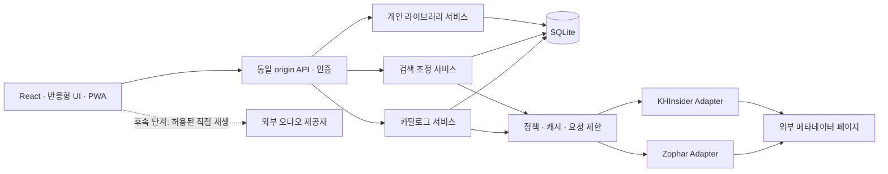

# LoopShelf MVP 아키텍처

상태: **소스 검증 모듈, SQLite·인증·북마크·JSON 이식 API/UI·기본 PWA·삭제 되돌리기·합성 카탈로그 및 개인 저장 API·탐색/새 저장·관리 UI 구현, 수집 통합은 계획** · 기준일: 2026-10-24

## 구조와 선택 이유

React 프런트엔드와 TypeScript 서버를 같은 origin으로 제공하는 단일 애플리케이션을 사용합니다. SQLite는 서버의 영속 볼륨에 두고, 외부 접근은 소스별 Adapter에 모읍니다. 음악 파일이 서버를 통과하지 않는 구조를 기본으로 합니다.

| 구성 | 기준안 | 선택 이유 |
| --- | --- | --- |
| 프런트엔드 | React + TypeScript + Vite | 사용자 요청에 맞는 SPA. 서버 렌더링은 첫 범위에 불필요. [Vite 문서](https://vite.dev/guide/) |
| 서버 | 지원되는 Node.js LTS + Fastify + TypeScript | Adapter, 인증, 입력 검증을 한 서버에서 관리. [Fastify 문서](https://fastify.dev/docs/latest/) |
| 저장소 | SQLite + better-sqlite3 + 버전 있는 SQL migration | 단일 인스턴스 운영과 트랜잭션을 단순화. [드라이버 문서](https://github.com/WiseLibs/better-sqlite3) |
| 검색 | SQLite FTS5 + 정규화된 이름/별칭 | 별도 검색 서버 없이 시작. 다국어 검색은 아래 제한을 보완. [FTS5 문서](https://www.sqlite.org/fts5.html) |
| HTML 처리 | Cheerio의 DOM 파싱 | 공개 HTML에서 구조적으로 추출. 원격 스크립트 실행 금지. [Cheerio 문서](https://cheerio.js.org/docs/basics/loading/) |
| 인증 | Better Auth + SQLite + 이메일/비밀번호, 비공개 설치의 제한된 계정 생성 | 검증된 인증 구현 사용. 세션은 서버에서 확인. [설치](https://better-auth.com/docs/installation), [이메일/비밀번호](https://better-auth.com/docs/authentication/email-password) |
| 검증 | 타입 검사, 단위/DB/Adapter 계약 테스트, 브라우저 E2E | 파서 변경·정체성 손실·권한 누출을 우선 검증 |

Cheerio 1.2.0, TypeScript 7.0.2, Fastify 5.12.7, better-sqlite3 13.0.3, Better Auth 1.7.10, @fastify/rate-limit 11.2.1, Zod 4.6.7에 React 19.3.1·Vite 8.3.5·@fastify/static 10.1.6·@fastify/middie 9.3.6을 추가해 버전을 고정했습니다. Node 24.21.0 LTS에서 strict 타입 검사·프로덕션 빌드·216개 Node 테스트·11개 Playwright 시나리오를 통과했습니다. SQLite 3.53.4의 FTS5/unicode61/trigram도 확인했습니다. 서버 실행은 Node type stripping, 브라우저 실행은 Vite 번들입니다. 외부 라이브러리의 Bun/브라우저 겸용 선언은 `skipLibCheck`로 제외하고 프로젝트 strict 검사는 유지합니다.

## 모듈 경계

예상 구조는 `apps/web`, `apps/server`, `packages/domain`, `packages/adapters`, `packages/database`입니다. 별도 배포 서비스가 아니라 한 저장소의 논리 경계입니다. 첫 구현에서 워크스페이스 설정이 불필요하게 커지면 동일 경계를 `src` 내부 모듈로 시작해도 됩니다.

현재 구현은 `src/sources`, `src/catalog`, `src/database`, `src/auth`, `src/library`, `src/server`, 타입 전용 `src/shared`와 React 화면의 `web/`입니다. `migrations/0001_auth.sql`은 고정 Better Auth 옵션으로 생성한 인증 스키마이고, `0002_catalog_library.sql`은 도메인·개인 데이터·검색 트리거이며 `0003_bookmark_connections.sql`은 수동 북마크의 개인 연결과 최소 변경 기록, `0004_import_revisions.sql`은 복원 시 수정 버전 재사용 방지와 감사 시각 처리입니다. `0005_bookmark_deletions.sql`은 세션에 묶인 60초 삭제 복구 스냅샷과 재시도 기록을 추가합니다. Fastify 서버 시작은 마이그레이션 버전/체크섬을 검사하며 SQL을 자동 적용하지 않습니다. [실행·운영 계약](docs/BACKEND.md)

`src/server/web.ts`는 개발 시 Vite middleware/WebSocket, 빌드 실행 시 `dist/` 정적 파일을 동일 origin에서 제공합니다. API 오류를 SPA로 숨기지 않고 기존 Host/Origin 검사를 유지합니다. UI는 상대 API 경로와 세션 쿠키를 사용하며 메모리에서만 개인 상태를 관리합니다. 현재 세션 ID 사전 조건으로 다른 창의 계정 전환 중 오래된 초안의 쓰기를 거절합니다. CSP는 빌드 실행에 적용하고 개발용 파일 제공 범위도 제한합니다. [프런트엔드 계약과 검증](docs/FRONTEND.md)

- domain: 출처 DTO와 canonical 엔티티의 타입, 값 정규화, 식별 규칙. 특정 HTML selector를 알지 못합니다.
- adapters: 소스별 URL 생성·HTML 추출·원본 ID·기능 범위. DB와 사용자 계정을 직접 수정하지 않습니다.
- catalog: 소스 레코드 upsert, provenance, provisional 엔티티, 상세 갱신. 개인 판단을 전역 병합으로 승격하지 않습니다.
- search: 로컬 검색, 제한된 원격 fan-out, 캐시, 결과 정규화와 소스별 상태.
- library: 사용자 소유권, 저장/즐겨찾기/메모/개인 출처 연결, 내보내기/복원.
- playback: 후속 모듈. Resource 해석과 재생 관찰을 담당하며 라이브러리 식별자를 바꾸지 않습니다.

### 합성 카탈로그 저장

`src/catalog/input.ts`가 파서 DTO의 strict 구조·한도·소스/URL/원본 키·수록 위치를 검증합니다. `CatalogStore`의 공개 메서드는 연결별 `withDatabase`를 사용하고, 페이지 전체를 동기 immediate 트랜잭션으로 저장합니다. CatalogStore 자체에는 HTTP·네트워크·fixture 자동 적재 경로가 없으며, 별도 소스 저장 HTTP 서비스가 정책/세션 확인 후 내부 조합 메서드를 사용합니다. 제품 live-capture 적재는 계속 거절합니다.

`0006_catalog_observations.sql`은 `catalog_observation`(정규화 자료·provenance·경고·검색 범위), `catalog_album_state`(최신 요약/상세·제목·트랙 채택 포인터), `catalog_track_origin`과 `assertion.observation_id`를 추가합니다. 기존 소스 키는 같은 Album UUID를 유지하며 기존 비관리 매핑과 충돌하면 자동 재지정하지 않습니다. capturedAt으로 최신 자료를 결정하고 상세 제목을 검색 표시명보다 우선합니다. parsedAt만 바뀐 재시도는 중복 관찰을 만들지 않습니다.

Track UUID는 첫 상세 목록과 명시적으로 채택한 새 트랙에 부여합니다. 최신 목록의 전체 관찰값이 달라지면 `review_required`로 보류하고 현재 트랙·개인 저장을 유지합니다. 문서 내 locator 변화는 비교에서 제외하며 그것을 전역 키로 쓰지 않습니다. 관찰과 실제 음악 동일성은 구분합니다. 실제 수집과 트랙 출처 연결은 후속 범위입니다. [카탈로그 계약과 검증](docs/CATALOG.md)

`0008_catalog_track_adoptions.sql`의 `catalog_track_binding`은 관찰별 수록 위치와 Track ID를, `catalog_track_adoption`은 요청 해시·기준/대상 관찰·결과 영수증을 보존합니다. 기존 `track.position`은 내부 할당 순번으로 남기고 현재 목록은 state의 tracks 관찰과 binding을 조인합니다. 운영자 `getTrackReview`는 읽기 트랜잭션, `adoptTrackList`는 명시적 전체 대응·누락 ID·stale 검사 뒤 immediate 트랜잭션을 사용합니다. 누락 ID와 첫 origin은 유지하고 재시도·실패 롤백·공유 관계 충돌을 처리합니다. 소스 제거 시 binding/채택 이력도 원자적으로 삭제합니다. [운영 계약](docs/TRACK_ADOPTION.md)

`0007_catalog_removals.sql`의 `catalog_removal`은 제거할 관찰과 독립된 소스/앨범 ID·사유·시각을 보존합니다. 운영자 전용 `CatalogStore.removeSource`는 `withDatabase`와 immediate 트랜잭션에서 공유/수동 근거 충돌을 검사하고 영수증·내용 제거·상태 변경을 함께 커밋합니다. Album/Track은 공통 안내와 구조적 ID를 남기고 개인 테이블은 수정하지 않습니다. 제거된 앨범 조회는 관찰 참조와 원래 목록을 노출하지 않으며 적재·SQL 제약으로 같은 소스 키의 재노출을 거절합니다. HTTP 경로는 없습니다. 과거 백업의 제거 결정 재적용과 물리적 잔존 데이터의 한계는 [제거 운영 계약](docs/CATALOG_REMOVAL.md)에 명시합니다.

### 카탈로그 개인 저장과 출처 연결

`src/library/catalog.ts`의 동기 `CatalogLibraryStore`를 `/api/library/catalog`에 연결했습니다. `forUser`가 실제 세션 조회와 개인 작업을 같은 `withDatabase`에 넣으며, 쓰기는 immediate·읽기는 deferred 트랜잭션으로 원자적 스냅샷을 유지합니다. 공유 DTO는 `src/shared/catalog-library.ts`입니다. 공용 수집/운영 명령의 HTTP 노출과 fixture 자동 적재는 추가하지 않습니다.

LibraryItem은 사용자별 UUID와 직접 입력한 override·메모·즐겨찾기만 저장합니다. 표시 제목·출처·현재 수록 위치·누락/제거 상태는 관리 카탈로그/제거 영수증에서 조회하므로 별도 제목 복사본을 만들지 않습니다. 개인 검색은 NFKC `instr`로 소유자 범위의 현재 제목·개인 내용·추가 출처 앨범 제목을 찾습니다. 공용 FTS·캐시·성능 최적화와 구분합니다.

기존 `user_source_link`의 소유권 복합 FK와 `(user_id,source_entity_id)` 유일성을 사용하고 `0009_catalog_library_links.sql`에 조회 인덱스·20개 제한·정체성 불변·UPDATE 금지와 최소 감사 기록을 추가했습니다. 서비스는 관리 앨범끼리의 명시적 연결만 허용하며 공용 매핑/별도 개인 저장 행을 합치지 않습니다. 개인 변경/연결은 최신 버전을 검사하고 같은 트랜잭션에서 버전·시각을 갱신합니다. 카탈로그 변경·제거는 개인 버전을 바꾸지 않습니다. `web/CatalogShelf.tsx`가 계정별 목록·필터·개인 편집/삭제·출처 조회/해제를 제공합니다. 기존 세션 사전 조건과 오프라인 gate를 공유하며 상태는 메모리에만 둡니다. 편집/해제/삭제의 충돌 또는 응답 유실 후에는 서버 재조회와 명시적인 재선택을 요구합니다. 출처 재조회는 목록에도 반영하고 분리된 화면의 요청은 취소합니다. `src/catalog/browse.ts`가 같은 인증/직렬화 경계에서 공용 합성 앨범·현재 binding 수록곡·소유한 저장의 후보를 읽습니다. `src/catalog/entities.ts`의 projection을 개인 서비스와 공유하며 별도 가용성 필터로 제거/차단/누락을 배제합니다. `web/CatalogBrowser.tsx`는 탐색/새 저장·후보 선택/개인 연결 확인을 제공하며 쓰기는 기존 개인 API를 재사용합니다. 검색은 현재 제목의 NFKC 리터럴 부분 검색이고 기본 12개·최대 100개를 반환합니다. 메타데이터 인덱스 복사본과 새 스키마는 추가하지 않았습니다. 목록/후보는 앨범 후보만 먼저 선택하고, 상세는 현재 관찰 ID의 binding 키로 수록곡을 읽은 뒤 공통 projection을 적용합니다. 통계 없는 DB에서 전체 Entity 스캔을 피하려고 앨범을 Entity보다 먼저 읽는 CROSS JOIN을 사용합니다. 이 결정은 1만/10만 합성 자료의 전후 실행 계획과 성능으로 검증했습니다. [측정·제한](docs/CATALOG_PERFORMANCE.md) [읽기 계약](docs/CATALOG_BROWSE.md). 카탈로그 개인 JSON과 원본 미연결 보존은 아래 이식 경계를 따릅니다. [상태·API·백업 계약](docs/CATALOG_LIBRARY.md)

### 개인 북마크 연결

`BookmarkStore`는 기존 사용자 북마크를 대표와 멤버로 연결합니다. `bookmark_connection`이 LibraryItem 두 개와 소유자를 참조하며 원래 Entity·제목·URL·메모·즐겨찾기를 유지합니다. 공용 SourceEntity/UserSourceLink와 별도 경계입니다. 연결/해제와 양쪽 `version` 증가, 최소 변경 기록은 같은 immediate 트랜잭션에 포함합니다. 멤버를 편집해도 대표 버전을 갱신하므로 관리 화면의 오래된 선택은 거절됩니다.

SQL 제약과 서비스가 같은 소유자·비중첩·대표 포함 최대 20개를 검사하고 연결된 항목 삭제를 막습니다. 검색 인덱스는 원본 행별로 유지합니다. 검색 시 소유자 범위의 일치 항목을 대표 ID로 치환해 중복을 없앤 뒤 정렬·페이지 이동을 적용합니다. 일반 목록과 즐겨찾기는 대표 기준이며 `standalone=true`는 연결 후보용입니다.

`web/Connections.tsx`는 후보 검색·원래 값 확인·연결·해제·직전 변경 되돌리기를 제공합니다. 오류 뒤에는 실제 상태를 재조회하고 양쪽 버전을 새로 확인합니다. 개인 정보는 기존 메모리·세션 경계를 따릅니다. 0002에서의 업그레이드와 연결을 포함한 백업/복원 후 해제까지 검증했으며 외부 네트워크 요청은 추가하지 않았습니다.

### JSON 이식

`src/library/transfer.ts`가 제한된 v1 파일을 검증하고 개인 북마크 전체 스냅샷을 읽습니다. 북마크 `loopshelf-bookmarks` v1 계약은 유지합니다. 별도 `src/library/catalog-transfer.ts`와 `catalog-archive.ts`가 `loopshelf-catalog` v1/v2 입력을 검증하고 v2로 내보내며 `catalog-references.ts`가 최소 참조/미연결 응답을 조립합니다. 카탈로그 메타데이터 없이 개인 ID·필드·출처 판단만 보존합니다. `src/shared/transfer.ts`는 타입·한도만 공유하며 `web/Transfer.tsx`가 메모리의 파일과 검사 결과를 관리합니다. 모든 API는 기존 세션·`withDatabase` 경계를 사용합니다. 입력 파일 자체는 서버 디스크나 DB에 보관하지 않습니다.

검사 토큰은 사용자·정규 검증된 파일 해시·현재 개인 스냅샷(수정 버전 포함) 해시·만료 시각에 대한 HMAC이며 인증 수단이 아닙니다. 적용 요청의 immediate 트랜잭션 안에서 토큰과 충돌을 다시 확인하고 새 행·검색 인덱스·연결·감사 기록을 함께 저장합니다. 기존 동일 항목은 건너뛰며 내용을 수정하지 않습니다. 다른 계정의 동시 ID 사용도 적용 직전에 재확인합니다. 삭제된 UUID의 복원은 `library_revision` 상한보다 큰 버전을 할당하여 오래된 편집 창의 쓰기를 거절합니다. [이식 한도·포맷·오류 계약](docs/DATA_TRANSFER.md)

`0010_catalog_transfer.sql`의 `catalog_detached_item/link`는 원본이 없는 설치의 개인 자료를 보존합니다. 항목 내 참조가 하나라도 미해결이면 전체 항목을 미연결로 저장하고 기존 개인 CRUD에서 통합 조회합니다. 공용 카탈로그 쓰기·URL 대응·자동 재연결은 없습니다. 모든 참조가 정확히 일치하면 기존 `library_item/user_source_link`에 복원하며 현재 누락/제거 상태를 유지합니다. 검사 HMAC에는 개인 버전/미연결 상태와 현재 참조의 해결/가용/제거 상태도 포함합니다. 파일별 원자적 복원과 양 테이블 간 ID/출처 점유 검사를 적용합니다. UI는 두 종류의 내보내기와 공통 검사/복원 화면을 제공합니다. [카탈로그 포맷·충돌 계약](docs/CATALOG_TRANSFER.md)

## Adapter 계약

아래는 최종 네트워크 Adapter의 책임 명세입니다. 현재 `src/sources/adapters.ts`의 `getSourceAdapters(db)`에서 검색/상세 Adapter·파서·SQLite 캐시를 연결했습니다. `captureSourcePage`는 고정 요청을 받아 CapturedPage를 반환하는 하위 경계입니다. 제품 정책은 닫혀 있으며 서버/UI·카탈로그 적재 연결은 미구현입니다. [Adapter·캐시 계약](docs/SOURCE_ADAPTERS.md) · [전송 계약](docs/SOURCE_TRANSPORT.md)

| 작업 | 입력 | 출력 / 규칙 |
| --- | --- | --- |
| capabilities | 소스 설정과 정책 상태 | 검색 유형, 상세 가능 여부, 페이지네이션, 재생 방식 및 정책 상태 |
| searchAlbums | query, source cursor?, AbortSignal | source-native 결과, 다음 cursor?, 원본 순서, warnings |
| getAlbum | source-native album key, AbortSignal | 앨범 DTO, 순서 있는 트랙 DTO, 근거 URL, 수집 시각, 누락 필드 |
| normalizePageUrl | 사용자 입력 URL | 지원 host/path의 정규 참조 또는 오류. 네트워크 접근 없이 판단 |
| resolveResource | 후속 단계의 녹음/출처 참조 | 허용된 경우만 임시 재생 URL·MIME·만료·확인 시각. 기본 unsupported |

공통 오류는 `blocked`, `rate_limited`, `timeout`, `not_found`, `parse_changed`, `policy_disabled`, `unsupported`로 구분합니다. 정상 0건은 성공 결과입니다. 선택자 실패를 빈 앨범이나 빈 검색 결과로 저장하지 않습니다.

소스별 최소 필수 데이터는 검색 결과의 제목·페이지 참조, 상세의 제목·트랙 목록 상태입니다. 트랙 0개는 실제 빈 목록인지 parser failure인지 분리합니다. 일부 선택 정보 누락은 warnings로 반환할 수 있습니다.

## 정책과 네트워크 계층

소스마다 검색, 상세, 캐시, 메타데이터 표시, 표지 표시, 직접 오디오, 임베드 정책을 별도로 보관합니다. 검증 코드의 키는 `search / album / cache / display / artwork / directAudio / embed`입니다. 값은 `allowed / denied / unknown`, 근거 URL, 검토일을 포함하며 상세 판단은 SOURCES.md에 기록합니다. 기술 능력과 정책 허용 상태를 같은 boolean으로 합치지 않습니다. unknown 상태를 자동 수집 활성화로 처리하지 않습니다.

### 단계 1에 구현한 경계

- `types.ts`: 출처 DTO. 검색 표시명과 상세 앨범 제목을 구분하고 canonical Entity/Recording UUID를 만들지 않습니다.
- `parsers.ts`: 입력 HTML·상태·헤더를 검사하고 Cheerio로 텍스트만 추출합니다. KHInsider 검색과 Zophar 검색/상세만 지원합니다. HTTP 오류, challenge, 구조 변경, 정상 0건을 분리하며 네트워크 호출이 없습니다.
- `urls.ts`: HTTPS 고정 origin과 앨범 경로를 검사합니다. 이는 문자열 정규화이며 transport의 별도 DNS/IP/redirect 검증을 대체하지 않습니다.
- `policies.ts`: 기능별 정책과 표본의 기술 상태를 분리합니다. 제품용 `productAccess`는 현재 모든 자동 수집·캐시·표시·재생 기능을 비활성으로 반환합니다. 후속 서비스는 **요청 또는 캐시 제공 전에** 이를 검사해야 합니다.
- `evidence.ts`, `scripts/inspect-source.ts`: 로컬 파일 검사와 최소 증거 출력. URL을 직접 가져오는 옵션은 없습니다. 실제 표본과 합성 fixture를 명시적으로 표시합니다.

`CapturedPage.capturedAt`은 취득 시각이며 `parsedAt`과 다릅니다. 파일 검사에서는 호출자가 제공하고 새 전송 계층에서는 본문 완료 시각을 기록합니다. 기존 표본에서 HTTP Date를 대신 쓴 경우 증거 JSON에 근사값임을 기록했습니다. 파서 버전과 본문 SHA-256으로 정상 파싱 표본을 추적합니다. 원본 HTML은 제품 캐시로 제공하지 않습니다.

### 단계 3 전송 구현과 남은 범위

`transport.ts`는 고정 제품 gate와 DB별 전송 인스턴스를 소유합니다. Adapter는 `getSourceCapture(db)`를 사용하고 같은 로컬 DB의 연결/프로세스가 영속 예약을 공유합니다. `transport/requests.ts`는 소스 키/검색어로만 주소를 생성하고 동일 리소스의 redirect만 허용합니다. `addresses.ts`는 반환된 DNS 주소 전체를 검사하고 `node-driver.ts`는 검증한 IP 하나에 HTTPS lookup을 고정하며 Host/SNI/인증서 검증을 유지합니다. 전용 Resolver 취소와 AbortSignal로 지연 작업을 정리합니다. 내부 `engine.ts`의 의존성 주입은 합성 테스트용 경계이며 제품 요청에서 바꿀 수 없습니다.

소스별 동시 1개·대기 8개, 시도 종료 후 최소 3초 간격, 호출 전체 10초, HTML 5 MiB, 헤더 16 KiB, redirect 2회와 429 cooldown을 구현했습니다. identity/UTF-8 HTML만 지원하고 자동 재시도는 하지 않습니다. 실패 뒤 요청 간격·대기 중 정책 변경·늦은 응답도 처리합니다. 제품 정책은 unknown이고 실제 접근 검토 목록도 비어 있어 자동 수집은 비활성입니다. `access-review.ts`는 정확한 URL별 수동 robots 결론·기한·명시적 수집 허가·집행 가능한 quota를 검사합니다. 최초 검토 revision을 전송에 묶고 대기/완료 뒤 재검사합니다. 자동 robots 파서나 실제 근거 취득은 포함하지 않습니다. [접근 검토 계약](docs/SOURCE_ACCESS_REVIEW.md) 최초 35개 전송 검증에 이어 0017의 영속 조정을 17개 검사로 확인했으며 실사이트·CORS 검증은 아닙니다. 상위 Adapter의 SQLite 캐시와 동일 요청 병합은 별도로 구현했습니다.

`source_request_state`는 고정 소스별 다음 시도/429 대기/최근 시각, `source_request_ticket`은 순번·token·owner·기한·waiting/reserved/running만 저장합니다. 한 holder와 대기 8개를 같은 SQLite 쓰기 트랜잭션으로 관리합니다. waiting/reserved는 만료 가능하지만 running은 실제 완료와 간격 저장 없이 자동 해제하지 않습니다. 고장/일시 정지된 worker의 늦은 요청과 새 worker의 중복 전송을 막기 위한 보수적 보류입니다. 모든 DB 작업은 `withDatabase`의 짧은 트랜잭션이며 네트워크 대기와 분리합니다. busy timeout은 조정 트랜잭션 동안만 0으로 두고 복구합니다. 429/완료 저장 실패와 시계 역행은 비공개 `network_error`로 중단하고 운영 상태를 유지합니다. 제품의 고정 정책 검사는 예약보다 먼저 실행합니다.

같은 호스트 시계·로컬 DB를 전제로 하며 여러 설치/DB·호스트·공유 외부 IP의 그룹 quota는 포함하지 않습니다. 백업/복원은 running과 cooldown을 보존하고 최신 제한을 과거 스냅샷이 자동 대체하지 않습니다. `source:requests inspect/recover/defer`는 운영자용입니다. 복구는 정확한 만료 token·모든 worker 중지 확인·검토한 미래 대기 시각을 요구하며, `defer`는 예약을 해제하지 않고 제한을 더 길게만 적용합니다. [전체 조정·시계·복구 계약](docs/SOURCE_COORDINATION.md)

다음 항목은 전체 목표이며 위에 구현된 범위 외의 허용된 실제 수집·카탈로그 적재는 아직 남아 있습니다. 검색 UI의 재시도는 사용자 제출로만 수행합니다.

1. Adapter가 만든 고정 HTTPS 호스트/경로만 요청합니다. 사용자 URL을 그대로 가져오는 범용 프록시 endpoint를 만들지 않습니다.
2. DNS·IP·포트·redirect의 매 단계에서 허용 목록과 사설/로컬 주소를 검사해 SSRF를 막습니다. 현재 타 호스트 redirect는 모두 거절하며 같은 리소스만 최대 2회 허용합니다.
3. 사이트의 robots·문서화된 제한·허용 범위가 우선입니다. 자체 기본값은 소스당 동시 1건, 시도 종료 후 간격 최소 3초, 큐 포함 timeout 10초, HTML 최대 5 MiB입니다. 이는 사이트의 공식 quota가 아닙니다. 두 사이트가 같은 운영 기반이면 그룹 공통 제한도 검토해야 합니다.
4. 동일 요청은 한 번만 수행하도록 합치고 캐시를 먼저 사용합니다. UI에서 검색 취소·화면 이탈 시 불필요한 작업을 중단합니다.
5. 429는 Retry-After를 존중하고 cooldown으로 전환합니다. 403/로그인 요구/봇 차단은 자동 재시도·UA 위장·대체 프록시로 해결하지 않습니다. 네트워크/5xx만 제한된 backoff 재시도를 허용합니다.
6. 원격 HTML·스크립트를 실행하거나 렌더링하지 않습니다. 필요한 텍스트와 검증된 URL만 반환합니다. 이미지도 권한 확인 전에는 자리표시자를 사용합니다.
7. 실패한 갱신은 마지막 정상 데이터로 덮어쓰지 않습니다. 정책상 금지·삭제된 콘텐츠는 stale 캐시 제공도 중단하고 최소 북마크와 상태만 남깁니다.

## 소스 앨범 상세 조회

`src/source-album.ts`는 고정 제품 의존성을, `source-album/input.ts`는 소스 키 입력을, `source-album/service.ts`는 상세 응답의 근거/자료 종류·시간 예산·취소·정책/만료/제거 재검사를 담당합니다. 기존 Adapter 캐시를 사용하되 카탈로그/개인 저장·음원 Resource를 생성하지 않습니다. 캐시/표시 허용 철회 시 해당 소스 캐시도 정리합니다.

`src/server/source-read.ts`로 검색과 상세의 최초/최종 실제 세션·Origin·4 KiB·12초 대기·연결 종료 처리를 공유합니다. `server/search.ts`에서 두 고정 서비스를 등록하며 IP당 합계 30회/분·합계 동시 16개의 공통 한도를 사용합니다. 상세 경로는 POST `/api/source-album`이며 원격 결과에 UUID를 붙이지 않습니다. `web/SourceAlbum.tsx`는 검색의 명시적 소스 선택으로 상세 창을 열며 `web/api.ts`의 공통 현재 세션 검사와 `web/source-album-response.ts`의 응답 문맥/자료 종류 검사를 거칩니다. 수록곡은 20행씩 메모리에서 표시하며 기한 만료·취소·오프라인·세션 전환 시 제거합니다. 검색과 클라이언트 대기 시간도 공유합니다. 공용 UUID/개인 저장은 만들지 않으며 실제 자료 적재는 후속입니다. [화면 경계](docs/SOURCE_ALBUM_UI.md) [전체 계약과 합성 검증](docs/SOURCE_ALBUM.md)

## 소스 상세에서 개인 저장으로의 내부 경계

`src/source-save.ts`는 실제 Better Auth 인스턴스·고정 제품 상세 서비스·별도 보관 정책을 결합합니다. 제품 정책은 unknown이고 live 저장소도 닫혀 있어 실제 요청/적재를 시작하지 않습니다. 내부 `source-save/service.ts`는 선택 fingerprint와 개인 필드만 받고 초기/최종 실제 세션·정책/자료 종류/파서/보관 기한·제거를 검사합니다. 소스 대기는 DB 밖에서 수행하고, `source-save/persistence.ts`는 합성 검증에서만 공용 관찰 적재와 개인 저장을 한 immediate 트랜잭션으로 처리합니다. 실패 시 신규 ID와 기존 메타데이터 변경을 모두 롤백합니다. `CatalogStore.ingestSyntheticInTransaction`은 이를 위한 호출자 소유 동기 트랜잭션 경계이며 live 입력을 계속 거절합니다.

현재 수명 검사는 저장 허용 시점의 검사입니다. 실제 메타데이터의 정책 revision/기한 영속화·만료 후 공용 내용 정리·개인 ID 보존·합성/live 격리와 모든 읽기/이식/복원 경로는 후속 모델에 필요합니다. 저장 HTTP endpoint·UI를 연결하거나 수집 정책을 열지 않았습니다. [입력·정책·재시도·검증 계약](docs/SOURCE_SAVE.md)

## 검색 흐름

현재 `src/search.ts`의 내부 통합 검색은 명시적으로 선택한 소스 Adapter를 병렬 실행하고, 응답 전 `withDatabase`에서 현재 로컬 카탈로그와 정책/제거 상태를 확인합니다. 로컬 앨범 우선 SQL을 기존 탐색과 공유합니다. 전체 비동기 대기 12초 중 소스 대기는 11초로 제한하여 마지막 DB 검사 시간을 남깁니다. 소스별 실패/0건/캐시/부분 페이지·취득 provenance를 별도로 반환하며 자동 병합·전역 순위·합산 고유 개수·상세 선취득은 하지 않습니다. 내부 합성 모드와 제품 live 모드를 분리하고 제품의 미지원 로컬 자료를 정상 0건으로 숨기지 않습니다. `POST /api/search`는 실제 세션과 필수 세션 조건을 검사하고 네트워크 대기 후 세션을 다시 확인합니다. 인증 DB 큐도 HTTP의 12초 제한에 포함하며 마지막 인증과 메타데이터 재검사를 같은 DB 경계에서 수행합니다. 요청 종료/서버 종료는 검색 구독을 취소하며 전송 완료를 기다리며 DB를 잠그지 않습니다. `web/MusicSearch.tsx`는 명시적 검색·소스별 상태/재시도·로컬 페이지 이동을 제공하고 입력 변경/이탈/오프라인/로그아웃 시 요청을 취소합니다. `web/api.ts`는 응답 사용자·세션 헤더와 현재 쿠키 세션을 모두 확인한 뒤 같은 요청·sampleKind의 결과만 표시합니다. 재시도는 해당 소스와 로컬 결과를 새로 받고 기존 결과를 교체합니다. 브라우저 영속 저장·자동 재전송은 없습니다. 개인 저장 표시·실제 자료 적재는 후속입니다. [검색 화면 계약](docs/SEARCH_UI.md) [서비스 계약](docs/SEARCH_SERVICE.md) · [HTTP 계약과 세션 전환의 범위](docs/SEARCH_API.md)

아래는 인증된 사용자 화면과 실제 수집까지 연결할 때의 목표 흐름입니다.

1. 사용자의 명시적 검색 제출을 받습니다. 길이·제어 문자·선택 소스를 검증하고 검색문을 정규화합니다.
2. library/catalog 범위의 로컬 검색을 먼저 수행합니다. 개인 영역은 서버 세션의 userId로 제한합니다.
3. 외부 검색을 선택한 경우 활성 소스마다 캐시 확인 후 제한된 요청을 실행합니다. 부분 성공은 유지하고 느린 소스가 전체 결과를 무기한 막지 않도록 전체 시간 예산을 둡니다.
4. 새 메타데이터는 소스 레코드와 provenance를 저장하고 검색 문서를 같은 트랜잭션에서 갱신합니다. 대량 자동 상세 취득은 하지 않고 사용자가 앨범을 열 때 상세를 가져옵니다.
5. 동일 SourceEntity의 중복만 확실히 제거합니다. 소스 간 유사 항목은 출처가 보이는 별도 결과 또는 후보 그룹으로 표시합니다.

반환에는 결과, sourceStatuses, fetchedAt, stale 여부, 범위, truncation/next cursor를 포함합니다. 첫 MVP는 제한된 첫 결과 페이지를 합치고 추가 조회는 소스별 cursor로 제공합니다. 소스가 지원하지 않는 페이지네이션을 만들어내지 않습니다. 원격 순위와 로컬 BM25 점수를 직접 같은 수치로 비교하지 않고 출처별 순위를 기준으로 합칩니다.

### 로컬 인덱스

기존 합성 앨범 검색은 NFKC 리터럴 부분 검색이며 별도 FTS/정규화 메타데이터 사본을 만들지 않습니다. 새 수록곡 검색은 아래 0014 표현식 인덱스를 사용합니다. 1만 앨범·10만 트랙·개인 저장 5천 개에서 24개 조회 사례의 최대 p95는 73.305ms였습니다. 개인 검색은 소유자 인덱스를, 현재 수록곡은 observation/position 인덱스를 사용합니다. 기본 CI는 실행 계획·결과 의미와 작은 CLI 실행을 검증하며 큰 측정은 `npm run bench:catalog`로 별도 실행합니다. [환경·원시 결과](docs/CATALOG_PERFORMANCE.md)

아래는 실제 외부 검색·별칭·전역 곡 검색을 연결할 때의 후속 설계입니다. 공용 catalog 검색 문서는 엔티티 ID, 종류, 정규화 제목, 별칭, 확인된 게임명·아티스트·플랫폼을 포함합니다. 개인 메모·직접 북마크는 별도 사용자 범위 인덱스에 둡니다. 공용 인덱스에 개인 필드를 섞지 않습니다.

FTS5 `unicode61`로 단어·접두어 검색을 제공하고, 공백 없는 한글·일본어의 부분 검색에는 trigram 인덱스를 보완적으로 검토합니다. trigram의 3자 미만 검색 한계 때문에 1–2자는 정규화된 이름/별칭의 제한된 prefix 또는 substring 조회로 처리합니다. 작은 카탈로그에서만 제한적 LIKE fallback을 허용하고 성능 측정 후 확장합니다. 영어용 stemming을 다국어 전체에 적용하지 않습니다. [SQLite 토크나이저 설명](https://www.sqlite.org/fts5.html#tokenizers)

FTS query 문법과 SQL은 별도로 안전하게 처리합니다. 사용자 문자열을 raw MATCH 문법이나 SQL에 이어 붙이지 않습니다. 결과 정렬은 정확한 제목/별칭 일치, 접두어, 일반 본문 일치 순으로 조정하고 동률은 안정적인 ID로 정렬합니다. 인덱스는 canonical 데이터로 재생성할 수 있어야 합니다.

## 캐시와 영속 데이터

`0011_source_metadata_cache.sql`은 소스/종류/요청 키/sampleKind별 정규화 DTO와 정책/파서 버전·취득/만료 시각을 저장합니다. 개인정보나 canonical Entity는 만들지 않습니다. `withDatabase` 안에서만 읽기/짧은 쓰기를 수행하고 네트워크 동안 연결 경계를 해제합니다. source removal 트리거가 해당 상세와 소스 검색 캐시를 정리하며 응답 완료·stale 대체 때도 제거 상태를 확인합니다.

Adapter 서비스는 동일 논리 요청을 병합하고 구독자별 취소를 분리합니다. 마지막 구독자가 취소하거나 첫 호출부터 12초가 지나면 늦은 응답의 DB 쓰기를 차단합니다. 아래 TTL을 초기 상한으로 구현했고 HTTP 보관 지시는 더 제한적인 값만 적용합니다. 캐시 200행/32 MiB·DTO 8 MiB 상한, 파서/정책 버전 불일치 비제공, 실패 대체와 정상 0건 15분을 합성 테스트로 검증했습니다. 실제 활성화에는 소스별 허용 기간 검토가 필요합니다. [상세 동작과 한계](docs/SOURCE_ADAPTERS.md)

| 데이터 | 제안 수명 | 정책 |
| --- | --- | --- |
| 검색 결과 | fresh 6시간, 허용 시 stale 최대 7일 | source + query + filters + locale + parserVersion 키 |
| 앨범 상세 | fresh 7일, 허용 시 stale 최대 30일 | 화면 접근 시 만료 확인. 운영자 요구가 더 짧으면 우선 적용 |
| 확인된 0건 | 15분 | 차단/파서 오류/timeout을 0건 캐시로 저장하지 않음 |
| robots/정책 검사 | 요청 정책에 맞춰 최대 24시간 이내 재확인 | 접근 실패·거부와 파일 부재를 구분. 허가 문서를 대체하지 않음 |
| Resource URL | 첫 MVP 없음. 후속은 만료 정보 우선 | 영구 ID로 사용하지 않고 필요할 때 재해석 |
| 개인 LibraryItem | 사용자가 삭제할 때까지 | 외부 캐시 만료와 독립. 사용자 입력 메타데이터 분리 |

위 TTL은 프로젝트 운영 기본값 제안입니다. 사이트가 제공한 cache 지시·재사용 조건을 우선합니다. HTTP validator가 있으면 조건부 요청을 고려합니다. 원본 HTML을 무기한 축적하지 않고 정규화 메타데이터와 파서 진단용 최소 정보만 보관합니다. 테스트 fixture는 합성 자료 또는 허용된 최소 표본을 사용합니다.

## SQLite 운영

현재 모든 연결은 FK·WAL·busy timeout 5초·synchronous FULL을 설정합니다. 도메인 테이블은 STRICT이고 검색 정규화 함수 `normalize_search`를 등록합니다. 마이그레이션 배치 전체와 적용 이력을 하나의 immediate 트랜잭션으로 처리하며 적용한 SQL의 체크섬 변경이나 알 수 없는 이력을 거절합니다.

인증은 비동기 Kysely 작업을, 북마크 저장소는 동기 better-sqlite3 트랜잭션을 사용합니다. 같은 연결에서 두 작업이 섞이지 않도록 HTTP 인증 처리와 `세션 조회 → 북마크 작업`, 로컬 계정 작업을 연결별 큐로 직렬화합니다. 큐 해제는 `finally`로 수행하며 네트워크 응답 완료를 기다리지 않습니다. 소규모 단일 서버를 위한 선택입니다. 합성 1만 앨범·10만 곡의 동시 1/4/8개 로컬 요청을 측정했고 최초 8개 조건의 p95 목표 미달을 확인한 뒤 앨범 제목 인덱스·수록곡 후보 조회로 같은 부하의 전체 p95를 568.480→30.720ms로 줄였습니다. 후속 여섯 분포도 별도 검증했으며 원격 배포 수용량은 미완료입니다. [측정 계약](docs/CATALOG_CONCURRENCY.md) · [분포별 결과와 한계](docs/CATALOG_SEARCH_PROFILES.md)

내부 `loopshelf.database.turn` 진단 채널은 구독자가 있을 때만 대기/점유 시간을 발행합니다. 순서·인증·동시성 경계를 바꾸지 않고 SQL/개인 내용/세션/DB 경로를 기록하지 않습니다. 벤치마크에서만 요청별로 묶으며 HTTP/env에서 켜는 기능이나 제품 응답 헤더는 추가하지 않습니다.

온라인 백업 API로 커밋된 WAL까지 복사한 후 스냅샷만 DELETE journal로 전환해 부속 파일 없이 보관합니다. integrity/FK 검사 후 성공을 보고하며 기존 출력 파일은 덮어쓰지 않습니다. 복원도 새 경로에만 수행합니다. 복원본에서 세션·verification을 한 트랜잭션으로 제거하고 세션 소유 삭제 복구 영수증은 FK cascade로 정리합니다. 원본 DB/백업·계정·개인 UUID·내용은 유지합니다. 일반 재시작은 세션을 유지하지만 복구 후에는 재로그인이 필요하므로 과거 폐기한 세션이나 열린 초안이 복원본에 쓰지 못합니다. 실제 CLI·서버 프로세스·브라우저와 PWA 재접속을 검증했습니다. 경로 전환과 인증/계정 변경 재적용은 [운영 절차](docs/OPERATIONS.md)를 따릅니다.

- 외래 키를 활성화하고 쓰기를 짧은 트랜잭션으로 제한합니다. 네트워크 호출 중 DB 트랜잭션을 열어 두지 않습니다.
- WAL과 busy timeout을 검증합니다. 읽기/쓰기를 개선해도 동시 writer 제약이 사라지는 것은 아닙니다. [SQLite WAL](https://www.sqlite.org/wal.html)
- 로컬 영속 디스크를 사용하는 단일 서버부터 시작합니다. 여러 인스턴스가 네트워크 공유 파일을 함께 쓰는 배포는 채택하지 않습니다.
- 앱과 인증 마이그레이션을 명시적으로 관리하고 backup → migration → smoke check 순서와 복구 절차를 둡니다.
- 실행 중 DB는 지원되는 backup API 등을 이용합니다. WAL을 무시한 DB 파일 복사를 백업으로 취급하지 않습니다. 복원 검증이 완료 조건입니다.
- 검색 인덱스·캐시는 재생성 가능하지만 개인 데이터는 그렇지 않으므로 백업 우선순위를 구분합니다.

## 인증과 개인 정보

기준안은 비공개 설치에서 운영자가 제한적으로 만든 계정과 이메일/비밀번호 로그인입니다. 공개 가입과 이메일 검증·재설정 서비스는 별도 운영 준비 전까지 노출하지 않습니다. 계정 복구는 인증 라이브러리의 지원 절차를 사용하는 운영 기능으로 계획하고, 직접 비밀번호 테이블을 편집하는 방식을 만들지 않습니다.

Better Auth를 연결해 두 계정의 실제 로그인과 소유권 격리를 검증했습니다. HTTP에는 로그인·로그아웃·세션 조회만 노출합니다. 계정 생성과 비밀번호 재설정은 서버에 마운트하지 않는 로컬 라이브러리 API로 수행하며, 재설정 토큰은 메모리에서만 전달하고 기존 세션을 폐기합니다. 인증 스키마가 라이브러리 요구와 일치하는지 테스트합니다. 기본 서버는 loopback에 바인딩하지만 단일 사용자 우회 모드는 없습니다.

모든 변경 요청은 정확한 `Origin`을 요구하며 Host도 구성된 앱 origin과 일치해야 합니다. 프록시 헤더는 신뢰하지 않고 socket IP로 로그인 제한을 적용합니다. 임의 `userId` 입력은 strict 스키마로 거절하고 다른 사용자의 단건 조회·수정·삭제는 동일하게 404를 반환합니다. HTTP 응답은 `Cache-Control: no-store`입니다. HTTPS origin에서 Secure/HttpOnly/SameSite 쿠키를 확인했지만 실제 TLS 프록시 배포는 후속 검증입니다. loopback HTTP 브라우저 E2E는 수행했습니다.

userId는 요청 body가 아닌 검증된 세션에서 결정합니다. 라이브러리·개인 연결·export/import·후속 플레이리스트·이력에 모두 소유권 검사를 적용합니다. HttpOnly 쿠키, 배포 시 Secure, 적절한 SameSite, mutation의 Origin/CSRF 검증, 로그인 rate limit을 적용합니다. 목록뿐 아니라 개별 ID 조회와 삭제·변경도 테스트합니다.

개인 API 응답은 공용 캐시에 저장하지 않습니다. 로그아웃 시 브라우저 메모리 캐시를 지웁니다. URL 가져오기, 내보내기, 로그에 외부 인증 키·세션·사용자 메모가 노출되지 않도록 합니다.

## 삭제 후 되돌리기

`BookmarkDeletions`는 삭제와 서버 스냅샷을 원자적으로 커밋하며 사용자·세션·클라이언트 operation UUID에 묶습니다. 복구는 전역 ID·사용자별 주소 충돌을 검사한 뒤 새 로컬 버전으로 원래 행과 검색 인덱스를 삽입하고 스냅샷을 비웁니다. 처리 완료 기록은 같은 60초 기한까지 남겨 재시도가 이후 변경을 되돌리지 않게 합니다. 삭제/복구 모두 `withDatabase` 안의 immediate 트랜잭션이며 만료 정리도 같은 경계로 직렬화합니다. 초기화·요청 전·10초 주기 정리, 세션 삭제 cascade, 사용자당 영수증 20개 제한을 둡니다. 기존 DELETE 계약은 유지하며 UI는 별도 POST 삭제/복구 API를 사용합니다. [사용·보관·오류·검증](docs/DELETION_UNDO.md)

## PWA와 플레이어 확장

구현된 Service Worker는 빌드가 지정한 공개 정적 앱 셸만 캐시합니다. 설치 시 모든 파일의 SHA-256을 검증하며 런타임 응답을 저장하지 않습니다. root 탐색은 네트워크 우선, 실패/5xx 시 정적 HTML로 복귀합니다. 새 worker는 모든 기존 창이 닫힐 때까지 대기하고 활성화 시 자신의 이전 버전 캐시만 정리합니다. `/api/*`, 인증, 개인 내보내기, 외부 음원은 캐시에서 제외합니다. 오프라인 시 개인 화면과 native dialog를 숨기되 React 초안은 유지하고, 온라인 복귀 후 세션 일치 시에만 복원합니다. [구체적인 경계·업데이트·검증](docs/PWA.md) 사적인 오프라인 목록과 오프라인 쓰기 큐는 후속 설계로 남깁니다. 설치에는 manifest와 보안 origin 등 브라우저 요구를 검증합니다. [MDN PWA 설치](https://developer.mozilla.org/en-US/docs/Web/Progressive_web_apps/Guides/Making_PWAs_installable)

후속 플레이어는 앱 전체에서 유지되는 HTMLAudioElement 한 개로 시작하고 Resource resolver와 UI를 분리합니다. 최초 재생은 사용자 동작으로 시작하며 autoplay 실패를 처리합니다. 무조건 Web Audio를 연결하지 않습니다. 메타데이터 서버와 음원 호스트의 CORS는 별개입니다. 실패하면 원문으로 안내하고 저장 항목은 유지합니다.

재생 이력은 SPEC.md의 관찰 기준에 따라 세션별로 저장합니다. 백그라운드 중단·탐색·반복·중복 요청·URL 만료·라디오 버퍼 지연을 테스트합니다. Rainwave 라디오는 Recording Resource와 다른 Station/Stream 모델을 추가해 곡별 온디맨드로 오인하지 않도록 합니다.

## 카탈로그 자료 종류와 보관 정리

`0012_catalog_retention.sql`은 SourceEntity별 종류 고정과 관찰의 원래 보관 기한/정책 revision을 추가합니다. 만료 시 JSON/assertion/검색 맥락을 정리하되 관찰·채택·개인 ID를 남깁니다. `reconcileCatalogRetention`은 같은 DB 직렬화 경계에서 공개/개인 조회·이식·시작/정리 주기에 실행하며, 백업/복원은 새 복사본에서 검사합니다. active lease 부분 인덱스로 전체 fixture 스캔을 피하고 실제로 마지막 채택한 근거에 따라 영향을 받은 앨범/곡만 정리합니다. 영구 제거 tombstone과 만료는 별도입니다. 공용 합성 탐색은 live를 제공하지 않으며 제품 writer는 닫혀 있습니다. 개인/운영 DTO와 JSON v2는 자료 종류를 보존합니다. [상세 계약](docs/CATALOG_RETENTION.md)

## 개인 참조 버전과 승인 수명 전달

`catalog-archive.ts`는 엄격한 v1/v2 입력을 검증한 뒤 내부 비교에는 참조별 sampleKind를 갖는 v2를 사용합니다. 검사 서명에는 원래 입력의 버전과 종류도 포함합니다. 기존 detached JSON의 종류 누락은 v1 synthetic으로만 읽으며 행을 재작성하지 않습니다. 새 행은 명시적 종류를 저장하고 0013의 INSERT 제약과 기존 불변 제약으로 보존합니다. 스키마 이력은 이전 앱의 잘못된 해석을 차단합니다.

`admitSourceAlbum`의 policyRevision/retainUntil은 `ingestRetainedAlbumInTransaction`에서 관찰 INSERT 또는 동일 관찰의 불변 lease 검사를 거칩니다. 이 경로는 서버 소유 DTO만 사용하고, live이면 고정 제품 정책도 별도로 검사합니다. 제품 정책 unknown과 저장 guard는 유지합니다. 개인 조회/export는 보관 정리 이후 최소 참조/직접 작성한 내용만 반환합니다. [자료 종류와 지원 범위](docs/CATALOG_KINDS.md)

### 소스 저장 HTTP와 상세 사전확인

`src/server/search.ts`는 검색·상세와 저장을 하나의 `createSourceRoutes`에 등록해 IP 횟수·동시 요청·취소/서버 종료·12초 예산을 공유합니다. 읽기는 마지막 인증 뒤 동기 recheck를 수행하고, 쓰기는 소스 저장 서비스의 commit 직전 실제 인증 결과를 사용해 바로 응답합니다. 내부 authenticated 정보는 헤더로만 전달하며 JSON 본문에서 제외합니다. 성공 응답 전송 중에는 DB 경계를 점유하지 않습니다.

상세의 save 필드는 최종 재검사 시 저장 서비스의 읽기 전용 selection으로 만듭니다. 가능한 경우만 정확한 관찰 fingerprint/기한을 제공하며 개인 자료나 UUID를 생성하지 않습니다. 저장 서비스는 같은 앱의 실제 인증과 고정 제품 정책을 사용하고 HTTP/env에 정책/인증/자료 종류 주입점을 두지 않습니다. 합성 API 성공 검증은 내부 메서드 교체만 사용합니다. [상세 계약과 검증](docs/SOURCE_SAVE_API.md)

### 소스 저장 화면과 정확한 개인 조회

`SourceAlbumSave`는 개인 입력 → 명시적 확인 → 저장과 불확실한 결과의 재조회 상태를 분리합니다. `source-save-response.ts`는 저장 안내/기한과 선택한 원본/종류의 결과를 검증합니다. `confirmedRequest`는 성공/실패 뒤 현재 쿠키의 실제 세션도 확인하며 취소/이탈한 작업은 반영하지 않습니다. 개인 초안만 메모리로 유지하고 원본 상세와 저장 기한은 독립적으로 만료시킵니다.

`GET /api/library/catalog/source-save`는 기존 `forUser` DB 경계와 필수 세션 조건으로 관리 SourceEntity의 정확한 Album UUID에 해당하는 소유자의 저장만 읽습니다. 제거 후에도 안정적인 종류/원본 ID를 사용하며 별도 관찰·인덱스·일치 추정·자동 재연결을 만들지 않습니다. 개인 조회와 상세 재확인 뒤 명시적 재선택으로 기존 저장 API를 호출합니다. [전체 상태·세션·검증 계약](docs/SOURCE_SAVE_UI.md)

### 카탈로그 수록곡 로컬 검색

`src/catalog/track-search.ts`는 외부 통합 검색과 분리된 합성 현재 수록곡 조회입니다. 실제 인증과 같은 DB 경계에서 보관 정리를 수행하고, 사용 가능한 앨범/현재 관찰을 한 번 확인한 뒤 정규화 제목 인덱스와 현재 binding으로 검색합니다. 작은 페이지를 정한 뒤 공개 DTO를 조립하며 개인 테이블·원격 소스·새 UUID를 사용하지 않습니다. 앨범 제목과 트랙 채택의 provenance를 따로 반환합니다.

0014의 `track(normalize_search(title), album_id, id)` 인덱스는 측정된 전역 트랙 조회 비용을 줄이기 위한 파생 구조입니다. canonical 제목 변경·만료·제거와 같은 SQLite 트랜잭션에서 갱신됩니다. `registerDatabaseFunctions`는 일반 연결과 백업/복원의 직접 SQLite 연결에 같은 결정적 정규화 함수를 제공합니다. `checkedAt`은 로컬 읽기 스냅샷 시각이며 외부 재검증이 아닙니다. 인증 GET API는 기존 offset과 `nextCursor` 연속 조회를 지원합니다. 커서는 공용 ID와 조건/정렬 근거 해시만 담고 인증을 대신하지 않습니다. 같은 읽기 트랜잭션에서 현재 기준 행을 확인한 뒤 제목 인덱스 범위/정렬 튜플로 이어 읽습니다. 형식/조건 불일치는 400, 자료 변경은 409입니다. React 연결을 완료했고 큰 offset의 파생 순서는 아래 0016에서 추가했습니다. 배포 부하는 별도 범위입니다. [계약](docs/CATALOG_TRACK_SEARCH.md)

### 수록곡 검색 화면

`CatalogTrackSearch`는 별도 합성 곡 제목 검색과 메모리 커서 경로를 관리합니다. 결과 본문을 누적/캐시하지 않고 이전 페이지도 다시 조회합니다. `catalog-track-response.ts`가 요청/자료 종류/URL/행/페이지 경계를 검사하고 서버 기준 수명에서 조회/세션 확인 시간을 뺍니다. 검색에서 앨범을 열면 기존 `CatalogBrowser`가 선택 UUID의 현재 페이지를 다시 확인해 저장 기능으로 연결합니다. 이 경로의 검색·상세·저장은 `confirmedRequest`로 현재 쿠키를 재확인하며 `forUser`의 인증된 응답에도 세션 헤더를 제공합니다. [상태와 검증](docs/CATALOG_TRACK_UI.md)

### 검색의 점유 비용 개선과 0015

`0015_catalog_album_search.sql`은 앨범의 정규화 제목 순서를 SQLite 인덱스로 유지합니다. 앨범 우선 읽기와 현재 제목/출처/키/UUID 정렬, 후보 연결/개인 소유권 경계를 유지합니다. 기존 전체 정렬 대신 제목 순서를 먼저 사용하며, 같은 제목은 기존 나머지 키로 정렬합니다.

수록곡 SQL은 `src/catalog/track-query.ts`에서 공통 가용성/관찰/현재 binding 검사를 유지합니다. offset 0/커서는 첫 일치 제목/출처 후보 256개, 부족하면 전체 정렬의 곡 후보 256개를 검사합니다. 첫 경로는 limit+1행, 보조 경로는 limit+1행 또는 같은 CTE의 원시 후보가 256 미만인 비어 있지 않은 마지막 페이지에 한해 결과를 사용합니다. 그 외에는 기존 전체 조회로 돌아갑니다. 정확히 256개를 소진으로 간주하지 않습니다. 기준 곡/제거/만료/실제 세션 경계는 같습니다. [최초 개선](docs/CATALOG_SEARCH_OPTIMIZATION.md) · [분포별 검증](docs/CATALOG_SEARCH_PROFILES.md) · [현재 소진 증명](docs/CATALOG_OFFSET_SEARCH.md)

### 큰 offset의 현재 검색 순서와 0016

`catalog_track_search_current` view는 전체 검색과 같은 가용성·관찰·현재 binding·첫 origin·합성 종류·제거 경계를 정의합니다. `catalog_track_search_index`는 그 결과의 UUID/출처 키·정규화 곡 제목·현재 위치/관찰만 유지하고 SQLite trigger가 영향받은 곡/앨범을 같은 쓰기 트랜잭션에서 갱신합니다. 개인 자료나 전체 응답을 복사하지 않으며 만료/제거 때 파생 제목도 정리합니다. FTS는 없습니다.

양수 offset은 전체 정렬 인덱스로 limit+1행의 키를 선택한 뒤 해당 앨범/곡의 원본 근거를 같은 읽기 트랜잭션에서 재검사합니다. 선택 키의 정렬/관찰 fingerprint가 다르면 성공을 거절합니다. 인덱스에서만 누락된 행은 이 페이지 검사만으로 모두 탐지할 수 없으므로 앱 시작·검증된 백업/복원에서 view와 양방향 차집합을 전수 비교합니다. 정상 쓰기는 trigger로 동기화하며 임의 원본/trigger 훼손을 지원하지 않습니다. 운영자 `catalog:reindex`는 정리 후 파생 목록만 원자적으로 재생성·검증합니다. 정규화 변경 시 0014/0015/0016을 함께 재생성하는 새 마이그레이션이 필요합니다. [측정 근거·갱신 비용·실패/복구 경계](docs/CATALOG_OFFSET_SEARCH.md)
