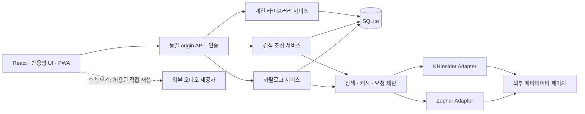

# LoopShelf MVP 아키텍처

상태: **계획안 / 미구현** · 기준일: 2026-10-18

## 구조와 선택 이유

React 프런트엔드와 TypeScript 서버를 같은 origin으로 제공하는 단일 애플리케이션을 제안합니다. SQLite는 서버의 영속 볼륨에 두고, 외부 접근은 소스별 Adapter에 모읍니다. 음악 파일이 서버를 통과하지 않는 구조를 기본으로 합니다.

| 구성 | 기준안 | 선택 이유 |
| --- | --- | --- |
| 프런트엔드 | React + TypeScript + Vite | 사용자 요청에 맞는 SPA. 서버 렌더링은 첫 범위에 불필요. [Vite 문서](https://vite.dev/guide/) |
| 서버 | 지원되는 Node.js LTS + Fastify + TypeScript | Adapter, 인증, 입력 검증을 한 서버에서 관리. [Fastify 문서](https://fastify.dev/docs/latest/) |
| 저장소 | SQLite + better-sqlite3 + 버전 있는 SQL migration | 단일 인스턴스 운영과 트랜잭션을 단순화. [드라이버 문서](https://github.com/WiseLibs/better-sqlite3) |
| 검색 | SQLite FTS5 + 정규화된 이름/별칭 | 별도 검색 서버 없이 시작. 다국어 검색은 아래 제한을 보완. [FTS5 문서](https://www.sqlite.org/fts5.html) |
| HTML 처리 | Cheerio의 DOM 파싱 | 공개 HTML에서 구조적으로 추출. 원격 스크립트 실행 금지. [Cheerio 문서](https://cheerio.js.org/docs/basics/loading/) |
| 인증 | Better Auth + SQLite + 이메일/비밀번호, 비공개 설치의 제한된 계정 생성 | 검증된 인증 구현 사용. 세션은 서버에서 확인. [설치](https://better-auth.com/docs/installation), [이메일/비밀번호](https://better-auth.com/docs/authentication/email-password) |
| 검증 | 타입 검사, 단위/DB/Adapter 계약 테스트, 브라우저 E2E | 파서 변경·정체성 손실·권한 누출을 우선 검증 |

패키지 버전은 착수 때 호환성·보안·런타임 지원을 확인해 고정합니다. 현재는 설치하지 않았습니다. SQLite 드라이버의 FTS5/trigram 지원을 실제 실행 환경에서 확인하는 것을 첫 기술 체크로 둡니다.

## 모듈 경계

예상 구조는 `apps/web`, `apps/server`, `packages/domain`, `packages/adapters`, `packages/database`입니다. 별도 배포 서비스가 아니라 한 저장소의 논리 경계입니다. 첫 구현에서 워크스페이스 설정이 불필요하게 커지면 동일 경계를 `src` 내부 모듈로 시작해도 됩니다.

- domain: 출처 DTO와 canonical 엔티티의 타입, 값 정규화, 식별 규칙. 특정 HTML selector를 알지 못합니다.
- adapters: 소스별 URL 생성·HTML 추출·원본 ID·기능 범위. DB와 사용자 계정을 직접 수정하지 않습니다.
- catalog: 소스 레코드 upsert, provenance, provisional 엔티티, 상세 갱신. 개인 판단을 전역 병합으로 승격하지 않습니다.
- search: 로컬 검색, 제한된 원격 fan-out, 캐시, 결과 정규화와 소스별 상태.
- library: 사용자 소유권, 저장/즐겨찾기/메모/개인 출처 연결, 내보내기/복원.
- playback: 후속 모듈. Resource 해석과 재생 관찰을 담당하며 라이브러리 식별자를 바꾸지 않습니다.

## Adapter 계약

첫 구현에서는 다음 계약을 타입으로 정의합니다. 지금은 실행 가능한 코드가 아닌 책임 명세입니다.

| 작업 | 입력 | 출력 / 규칙 |
| --- | --- | --- |
| capabilities | 소스 설정과 정책 상태 | 검색 유형, 상세 가능 여부, 페이지네이션, 재생 방식 및 정책 상태 |
| searchAlbums | query, source cursor?, AbortSignal | source-native 결과, 다음 cursor?, 원본 순서, warnings |
| getAlbum | source-native album key, AbortSignal | 앨범 DTO, 순서 있는 트랙 DTO, 근거 URL, 수집 시각, 누락 필드 |
| normalizePageUrl | 사용자 입력 URL | 지원 host/path의 정규 참조 또는 오류. 네트워크 접근 없이 판단 |
| resolveResource | 후속 단계의 녹음/출처 참조 | 허용된 경우만 임시 재생 URL·MIME·만료·확인 시각. 기본 unsupported |

공통 오류는 `blocked`, `rate_limited`, `timeout`, `not_found`, `parse_changed`, `policy_disabled`, `unsupported`로 구분합니다. 정상 0건은 성공 결과입니다. 선택자 실패를 빈 앨범이나 빈 검색 결과로 저장하지 않습니다.

소스별 최소 필수 데이터는 검색 결과의 제목·페이지 참조, 상세의 제목·트랙 목록 상태입니다. 트랙 0개는 실제 빈 목록인지 parser failure인지 분리합니다. 일부 선택 정보 누락은 warnings로 반환할 수 있습니다.

## 정책과 네트워크 계층

소스마다 `metadataSearch`, `metadataDetail`, `metadataCache`, `artworkDisplay`, `directAudio`, `embed` 정책을 별도로 보관합니다. 값은 `allowed / denied / unknown`, 근거 URL, 검토일, 검토 메모를 포함합니다. 기술 능력과 정책 허용 상태를 같은 boolean으로 합치지 않습니다. unknown 상태를 자동 수집 활성화로 처리하지 않습니다.

1. Adapter가 만든 고정 HTTPS 호스트/경로만 요청합니다. 사용자 URL을 그대로 가져오는 범용 프록시 endpoint를 만들지 않습니다.
2. DNS·IP·포트·redirect의 매 단계에서 허용 목록과 사설/로컬 주소를 검사해 SSRF를 막습니다. 타 호스트 redirect는 별도 검증하며 제한된 횟수만 허용합니다.
3. 사이트의 robots·문서화된 제한·허용 범위가 우선입니다. 자체 기본값은 소스당 동시 1건, 요청 간격 최소 3초, timeout 10초, HTML 최대 5 MiB로 제안합니다. 이는 사이트의 공식 quota가 아닙니다. 두 사이트가 같은 운영 기반이면 그룹 공통 제한도 둡니다.
4. 동일 요청은 한 번만 수행하도록 합치고 캐시를 먼저 사용합니다. UI에서 검색 취소·화면 이탈 시 불필요한 작업을 중단합니다.
5. 429는 Retry-After를 존중하고 cooldown으로 전환합니다. 403/로그인 요구/봇 차단은 자동 재시도·UA 위장·대체 프록시로 해결하지 않습니다. 네트워크/5xx만 제한된 backoff 재시도를 허용합니다.
6. 원격 HTML·스크립트를 실행하거나 렌더링하지 않습니다. 필요한 텍스트와 검증된 URL만 반환합니다. 이미지도 권한 확인 전에는 자리표시자를 사용합니다.
7. 실패한 갱신은 마지막 정상 데이터로 덮어쓰지 않습니다. 정책상 금지·삭제된 콘텐츠는 stale 캐시 제공도 중단하고 최소 북마크와 상태만 남깁니다.

## 검색 흐름

1. 사용자의 명시적 검색 제출을 받습니다. 길이·제어 문자·선택 소스를 검증하고 검색문을 정규화합니다.
2. library/catalog 범위의 로컬 검색을 먼저 수행합니다. 개인 영역은 서버 세션의 userId로 제한합니다.
3. 외부 검색을 선택한 경우 활성 소스마다 캐시 확인 후 제한된 요청을 실행합니다. 부분 성공은 유지하고 느린 소스가 전체 결과를 무기한 막지 않도록 전체 시간 예산을 둡니다.
4. 새 메타데이터는 소스 레코드와 provenance를 저장하고 검색 문서를 같은 트랜잭션에서 갱신합니다. 대량 자동 상세 취득은 하지 않고 사용자가 앨범을 열 때 상세를 가져옵니다.
5. 동일 SourceEntity의 중복만 확실히 제거합니다. 소스 간 유사 항목은 출처가 보이는 별도 결과 또는 후보 그룹으로 표시합니다.

반환에는 결과, sourceStatuses, fetchedAt, stale 여부, 범위, truncation/next cursor를 포함합니다. 첫 MVP는 제한된 첫 결과 페이지를 합치고 추가 조회는 소스별 cursor로 제공합니다. 소스가 지원하지 않는 페이지네이션을 만들어내지 않습니다. 원격 순위와 로컬 BM25 점수를 직접 같은 수치로 비교하지 않고 출처별 순위를 기준으로 합칩니다.

### 로컬 인덱스

공용 catalog 검색 문서는 엔티티 ID, 종류, 정규화 제목, 별칭, 확인된 게임명·아티스트·플랫폼을 포함합니다. 개인 메모·직접 북마크는 별도 사용자 범위 인덱스에 둡니다. 공용 인덱스에 개인 필드를 섞지 않습니다.

FTS5 `unicode61`로 단어·접두어 검색을 제공하고, 공백 없는 한글·일본어의 부분 검색에는 trigram 인덱스를 보완적으로 검토합니다. trigram의 3자 미만 검색 한계 때문에 1–2자는 정규화된 이름/별칭의 제한된 prefix 또는 substring 조회로 처리합니다. 작은 카탈로그에서만 제한적 LIKE fallback을 허용하고 성능 측정 후 확장합니다. 영어용 stemming을 다국어 전체에 적용하지 않습니다. [SQLite 토크나이저 설명](https://www.sqlite.org/fts5.html#tokenizers)

FTS query 문법과 SQL은 별도로 안전하게 처리합니다. 사용자 문자열을 raw MATCH 문법이나 SQL에 이어 붙이지 않습니다. 결과 정렬은 정확한 제목/별칭 일치, 접두어, 일반 본문 일치 순으로 조정하고 동률은 안정적인 ID로 정렬합니다. 인덱스는 canonical 데이터로 재생성할 수 있어야 합니다.

## 캐시와 영속 데이터

| 데이터 | 제안 수명 | 정책 |
| --- | --- | --- |
| 검색 결과 | fresh 6시간, 허용 시 stale 최대 7일 | source + query + filters + locale + parserVersion 키 |
| 앨범 상세 | fresh 7일, 허용 시 stale 최대 30일 | 화면 접근 시 만료 확인. 운영자 요구가 더 짧으면 우선 적용 |
| 확인된 0건 | 15분 | 차단/파서 오류/timeout을 0건 캐시로 저장하지 않음 |
| robots/정책 검사 | 요청 정책에 맞춰 최대 24시간 이내 재확인 | 접근 실패·거부와 파일 부재를 구분. 허가 문서를 대체하지 않음 |
| Resource URL | 첫 MVP 없음. 후속은 만료 정보 우선 | 영구 ID로 사용하지 않고 필요할 때 재해석 |
| 개인 LibraryItem | 사용자가 삭제할 때까지 | 외부 캐시 만료와 독립. 사용자 입력 메타데이터 분리 |

위 TTL은 프로젝트 운영 기본값 제안입니다. 사이트가 제공한 cache 지시·재사용 조건을 우선합니다. HTTP validator가 있으면 조건부 요청을 고려합니다. 원본 HTML을 무기한 축적하지 않고 정규화 메타데이터와 파서 진단용 최소 정보만 보관합니다. 테스트 fixture는 합성 자료 또는 허용된 최소 표본을 사용합니다.

## SQLite 운영

- 외래 키를 활성화하고 쓰기를 짧은 트랜잭션으로 제한합니다. 네트워크 호출 중 DB 트랜잭션을 열어 두지 않습니다.
- WAL과 busy timeout을 검증합니다. 읽기/쓰기를 개선해도 동시 writer 제약이 사라지는 것은 아닙니다. [SQLite WAL](https://www.sqlite.org/wal.html)
- 로컬 영속 디스크를 사용하는 단일 서버부터 시작합니다. 여러 인스턴스가 네트워크 공유 파일을 함께 쓰는 배포는 채택하지 않습니다.
- 앱과 인증 마이그레이션을 명시적으로 관리하고 backup → migration → smoke check 순서와 복구 절차를 둡니다.
- 실행 중 DB는 지원되는 backup API 등을 이용합니다. WAL을 무시한 DB 파일 복사를 백업으로 취급하지 않습니다. 복원 검증이 완료 조건입니다.
- 검색 인덱스·캐시는 재생성 가능하지만 개인 데이터는 그렇지 않으므로 백업 우선순위를 구분합니다.

## 인증과 개인 정보

기준안은 비공개 설치에서 운영자가 제한적으로 만든 계정과 이메일/비밀번호 로그인입니다. 공개 가입과 이메일 검증·재설정 서비스는 별도 운영 준비 전까지 노출하지 않습니다. 계정 복구는 인증 라이브러리의 지원 절차를 사용하는 운영 기능으로 계획하고, 직접 비밀번호 테이블을 편집하는 방식을 만들지 않습니다.

인증 라이브러리는 후보이며 Fastify 연결·SQLite 마이그레이션·계정 관리가 정상 동작하는지 기반 단계에서 확인합니다. 네트워크에 노출되는 MVP는 인증과 사용자 격리 테스트를 반드시 포함합니다. 로컬 개발용 단일 사용자 모드는 loopback 한정 테스트 편의 기능일 뿐 사용자별 라이브러리의 완료 조건을 대체하지 않습니다.

userId는 요청 body가 아닌 검증된 세션에서 결정합니다. 라이브러리·개인 연결·export/import·후속 플레이리스트·이력에 모두 소유권 검사를 적용합니다. HttpOnly 쿠키, 배포 시 Secure, 적절한 SameSite, mutation의 Origin/CSRF 검증, 로그인 rate limit을 적용합니다. 목록뿐 아니라 개별 ID 조회와 삭제·변경도 테스트합니다.

개인 API 응답은 공용 캐시에 저장하지 않습니다. 로그아웃 시 브라우저 메모리 캐시를 지웁니다. URL 가져오기, 내보내기, 로그에 외부 인증 키·세션·사용자 메모가 노출되지 않도록 합니다.

## PWA와 플레이어 확장

MVP의 Service Worker는 버전 있는 앱 정적 자산과 오프라인 안내만 캐시합니다. `/api/auth`, `/api/library`, 개인 내보내기, 외부 음원은 캐시에서 제외합니다. 사적인 오프라인 목록과 오프라인 쓰기 큐는 후속 설계로 남깁니다. 설치에는 manifest와 보안 origin 등 브라우저 요구를 검증합니다. [MDN PWA 설치](https://developer.mozilla.org/en-US/docs/Web/Progressive_web_apps/Guides/Making_PWAs_installable)

후속 플레이어는 앱 전체에서 유지되는 HTMLAudioElement 한 개로 시작하고 Resource resolver와 UI를 분리합니다. 최초 재생은 사용자 동작으로 시작하며 autoplay 실패를 처리합니다. 무조건 Web Audio를 연결하지 않습니다. 메타데이터 서버와 음원 호스트의 CORS는 별개입니다. 실패하면 원문으로 안내하고 저장 항목은 유지합니다.

재생 이력은 SPEC.md의 관찰 기준에 따라 세션별로 저장합니다. 백그라운드 중단·탐색·반복·중복 요청·URL 만료·라디오 버퍼 지연을 테스트합니다. Rainwave 라디오는 Recording Resource와 다른 Station/Stream 모델을 추가해 곡별 온디맨드로 오인하지 않도록 합니다.
