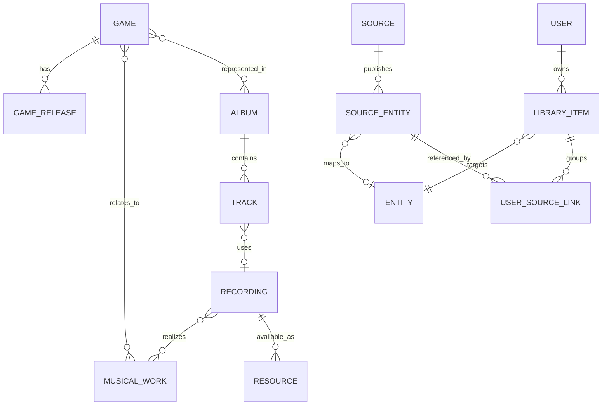

# LoopShelf 기능 및 데이터 모델 명세

상태: **개인 북마크·PWA·합성 카탈로그·개인 이식 구현, 소스 Adapter·SQLite 캐시·통합 검색 API/화면·소스 앨범 상세 서비스/API 검증 완료. 실제 자동 수집은 비활성** · 기준일: 2026-10-24

## 제품 범위

장기 목표는 통합 검색, 게임·앨범·곡 탐색, 가능한 음악의 스트리밍, 즐겨찾기·플레이리스트, 검증 가능한 자동 청취 기록, 사용자별 개인 라이브러리입니다.

첫 MVP는 **음원을 재생하지 못해도 가치가 있는 개인 음악 카탈로그**로 정의합니다. 소규모 비공개 셀프호스팅, 하나의 서버와 SQLite 파일을 기준으로 합니다. 공개 가입·상업 운영·모든 아카이브의 전수 인덱싱은 첫 범위에 포함하지 않습니다.

## 첫 MVP

| 기능 | 범위 | 완료 조건 |
| --- | --- | --- |
| 통합 검색 | KHInsider·Zophar의 허용된 앨범 검색 + 로컬 인덱스 | 결과마다 출처·유형·확인 시각 표시. 소스 실패/0건/캐시 결과 구분 |
| 앨범 탐색 | 앨범 정보, 순서 있는 수록곡 목록, 원문 링크 | 같은 번호가 반복되는 트랙과 메타데이터 누락을 손실 없이 표시 |
| 게임 연결 | 확인된 게임 관계로 앨범 탐색 | 제목 추측만으로 게임 관계를 확정하지 않음. 미연결 상태 허용 |
| 개인 라이브러리 | 앨범·곡 저장/제거, 즐겨찾기, 개인 메모 | 새로고침·서버 재시작·소스 장애 뒤에도 저장 내용 유지 |
| 직접 북마크 | 지원 소스의 페이지 URL과 사용자 입력 제목 저장 | 외부 수집 없이도 생성 가능. 자동으로 확인된 메타데이터와 구분 |
| 개인 항목 통합 | 같은 음악에 해당하는 여러 출처를 한 저장 항목에 연결/해제 | 다른 사용자와 전역 카탈로그에 영향을 주지 않고 되돌릴 수 있음 |
| 사용자 격리 | 비공개 설치의 계정·로그인·로그아웃·세션 | 다른 사용자 ID나 항목 ID를 넣어도 조회·수정 불가 |
| 반응형 UI | 검색, 앨범 상세, 내 라이브러리, 소스 상태, 계정 화면 | 모바일 360px 및 데스크톱에서 키보드·터치로 주요 흐름 완료 |
| 기본 PWA | manifest, 아이콘, 앱 셸, 오프라인 안내 | 지원 브라우저 설치 확인. 오프라인에서 작업 성공을 가장하지 않음 |
| 개인 데이터 이식 | 버전 있는 JSON 내보내기/복원 | 사용자 메모·즐겨찾기·출처 연결·안정 ID를 보존. 미디어 제외 |

현재 조사만으로 두 소스의 자동 수집을 활성화할 수 있다고 확정하지 않습니다. 소스별 검증 통과 범위만 켭니다. KHInsider 상세 차단이 지속되면 해당 상세는 원문 열기/기존 캐시/직접 북마크로 제한하고 **부분 연동**으로 표시합니다. 이 경우 두 소스의 전체 상세 연동 목표는 미완료로 남깁니다.

## 다음 단계로 분리할 기능

전송 계층과 검색/상세 Adapter·SQLite 메타데이터 캐시를 연결했습니다. 정상 0건·부분 결과·실패·stale을 구분하며 정책/파서 버전·만료·제거와 동일 요청의 취소 소유권을 확인합니다. 내부 통합 검색 서비스는 로컬/소스별 결과와 provenance를 구분하고 12초 예산·취소·최종 정책/만료/제거 검사를 수행합니다. 합성 검증 결과이며 제품의 두 소스는 `policy_disabled`입니다. 제품 live 검색에는 합성 카탈로그를 섞지 않고 로컬 `sample_kind_unavailable`을 명시합니다. 인증된 검색 HTTP API는 최초/최종 세션 확인·요청 제한·연결 취소까지 검증했습니다. React 검색 화면은 출처별 상태·수동 재시도·취소·응답 세션/현재 쿠키 재확인까지 연결했습니다. 정상/부분/캐시 성공 화면은 합성 브라우저 응답으로 검증했습니다. [화면 계약](docs/SEARCH_UI.md) 소스 상세 조회 서비스·인증 API도 연결했으며 반복 트랙 번호·근거·캐시/실패·최종 인증/정책/제거 검사를 합성 자료와 실제 임시 세션으로 검증했습니다. [상세 계약](docs/SOURCE_ALBUM.md) React 상세 화면도 검색 결과의 명시적 선택과 연결했습니다. 상세 제목/원문 주장·반복 번호·미확인 길이·20곡 페이지·캐시/실패·취소/만료·세션/자료 종류 검증과 공통 대기 시간을 유지합니다. [상세 화면](docs/SOURCE_ALBUM_UI.md) 후속 저장 입력·별도 보관 정책·선택 관찰 조건과 원자적 적재/개인 저장 내부 흐름도 합성 자료·실제 임시 세션으로 검증했습니다. 실제 자료는 storage gate와 합성 SQL 경계에서 계속 거절하고 저장 HTTP/UI는 추가하지 않았습니다. [저장 계약](docs/SOURCE_SAVE.md) live 카탈로그 적재와 실제 연동은 남아 있으며 robots/path·허용 범위와 보관 기간의 별도 검토가 필요합니다. [Adapter·캐시 계약](docs/SOURCE_ADAPTERS.md) · [통합 검색 계약](docs/SEARCH_SERVICE.md) · [인증된 검색 API](docs/SEARCH_API.md)

- 앱 내 스트리밍, 재생 큐, 기본 플레이리스트와 순서 편집, Media Session.
- 실제 앱 재생을 확인한 청취 이력. 외부 사이트 열기 이력과 별도 관리.
- Rainwave 라디오, OC ReMix 피드, 다른 메타데이터 소스 추가.
- 오프라인 개인 라이브러리 열람/동기화, 고급 추천·유사곡·자동 식별.
- 칩 음악 에뮬레이션, 서버 트랜스코딩, 오디오 다운로드/보관은 첫 플레이어 확장에도 기본 제외.
- Decl은 저장소와 분리된 실험으로 검토. MVP의 데이터 영속성·검색에 필수로 넣지 않음.

## 사용자 흐름

현재 구현한 화면은 로그인 → 내 북마크 목록/검색 → URL 직접 저장 → 즐겨찾기/메모/편집/삭제 → 개인 출처 연결/해제입니다. 소스 이용 안내와 계정 조회, 내 계정에서 JSON 내보내기·복원 전 검사·가져오기를 포함합니다. 검색은 개인 제목·메모만 대상으로 하며 외부 검색 결과나 앨범 수록곡을 생성하지 않습니다. 아래 통합 카탈로그 흐름의 전체 완료와 구분합니다. [화면 계약](docs/FRONTEND.md)

1. 로그인한 사용자가 검색어를 제출합니다. 로컬 결과와 활성화된 외부 소스의 결과를 출처·상태와 함께 봅니다.
2. 앨범을 열면 캐시가 있으면 먼저 표시하고, 허용된 경우 상세를 취득합니다. 오래된 캐시에는 갱신 시각을 표시합니다.
3. 앨범 또는 곡을 라이브러리에 저장합니다. 재생 불가 항목도 저장할 수 있습니다.
4. 같은 항목의 다른 출처를 발견하면 기존 개인 항목에 연결하거나 별도 버전으로 저장합니다.
5. 연동이 불가능하면 지원 소스의 페이지 URL과 제목을 직접 저장합니다. 원문 열기는 새 탭에서 수행하며 청취 이력을 만들지 않습니다.

빈 검색어, 검색 중, 결과 없음, 일부 소스 실패, 전체 소스 실패, 로그인 만료, 저장 실패, 오프라인을 서로 다른 상태로 표현합니다. 사이트 상태와 사용자에게 필요한 다음 행동을 보여주며 내부 파서 정보는 운영 로그에 둡니다.

## 음악의 정체성

| 개념 | 의미 | 구분 예 |
| --- | --- | --- |
| Game | 게임이라는 작품 | 같은 게임의 플랫폼별 발매는 GameRelease로 구분 |
| GameRelease | 플랫폼·지역·발매 시점이 다른 게임 버전 | SNES판, DS판 |
| MusicalWork | 추상적인 음악 작품/곡 | 같은 멜로디를 여러 녹음에서 사용 가능 |
| Recording | 특정 연주·렌더링·편집·믹스·루프의 녹음 버전 | OST 마스터, 칩 렌더링, 루프/페이드가 다른 버전 |
| Album | 발매판 또는 아카이브가 구성한 곡 모음 | 정식 OST, 재발매판, gamerip, 편곡 앨범 |
| Track | 앨범에서 녹음이 수록된 위치 | 디스크·표시 번호·정렬 순서·표시 제목 |
| SourceEntity | 특정 사이트의 앨범/곡/게임 레코드 | 소스 ID, 소스 내부 키, 페이지 URL, 출처 정보 |
| Resource | 특정 Recording을 실제 재생할 수 있는 외부 자원 | MP3 URL, MIME, 만료 시각, 정책과 기술 상태 |

MP3와 FLAC이 같은 마스터의 인코딩이라면 같은 Recording의 다른 Resource일 수 있습니다. 루프 수·연주·편곡·렌더링이 다르면 별도 Recording으로 유지합니다. 서로 다른 앨범의 Track이 같은 Recording을 참조할 수도 있습니다.

편곡/리믹스는 필요할 때 별도 MusicalWork와 원곡 관계(`arrangement_of`, `remix_of`)를 둡니다. 메들리는 여러 Work를 표현할 수 있으므로 Recording–Work는 다대다입니다. 이 관계를 추론할 근거가 없으면 비워 두며 트랙마다 확정된 원곡 관계를 만들어내지 않습니다.

Entity는 Game/Album/Track/Recording/Work/Bookmark 등 도메인 항목의 공통 ID 레지스트리입니다. SourceEntity는 이에 연결되며 Resource와 혼동하지 않습니다. 게임·앨범 관계는 컴필레이션을 위해 다대다로 둡니다.

## 논리 저장 구조

아래는 전체 논리 설계입니다. `migrations/`에 최소 도메인·인증·북마크 스키마와 0011의 재생성 가능한 소스 메타데이터 캐시를 작성했습니다. GameRelease·Alias·Resource 등 후속 테이블은 아직 도입하지 않았습니다.

| 영역 | 주요 엔티티 / 필드 | 제약 |
| --- | --- | --- |
| 공통 ID | Entity: id, kind, createdAt, lifecycle | 내부 UUID 유지. 외부 URL을 기본 키로 쓰지 않음 |
| 카탈로그 | Album: title, kind, releaseDate, datePrecision, catalogNumber | 발매판 단위. gamerip은 정식 발매와 구분. 미확인 값은 null |
| 수록곡 | Track: albumId, recordingId?, position, discLabel?, trackLabel?, title, durationMs? | position은 정렬 값. 표시 번호는 반복 가능. 시간 미상과 0초 구분 |
| 음악 관계 | Game, GameRelease, MusicalWork, Recording, 관계 테이블 | 최소 메타데이터만 있으면 source-derived/provisional 상태 허용 |
| 출처 | SourceEntity: sourceId, externalKind, externalKey, entityId?, pageUrl, fetchedAt, parserVersion, availability | `(sourceId, externalKind, externalKey)` 유일. URL 변경 이력 별도 유지 |
| 메타데이터 근거 | Assertion: entityId, field/relation, value, sourceEntityId, observedAt, confidence, method | 원본 주장과 채택한 표시값 구분. 사용자 메모를 수집기로 덮어쓰지 않음 |
| 이름 | Alias: entityId, locale, text, normalizedText, provenance | 원문 유지. 영문·일문·한글 이름을 증거 없이 동일시하지 않음 |
| 개인 저장 | LibraryItem: id, userId, entityId, titleOverride?, note?, favorite, createdAt, updatedAt | `(userId, entityId)` 유일. 사용자 지정 내용은 개인 영역에만 저장 |
| 개인 출처 연결 | UserSourceLink: userId, libraryItemId, sourceEntityId, assertedAt | 소유권 일치. `(userId, sourceEntityId)` 유일. 연결/해제 감사 기록 |
| 북마크 묶기 | BookmarkConnection: memberId, parentId, userId, connectedAt | 소유자가 같은 개인 북마크만. 원래 LibraryItem/Bookmark 행을 보존. 대표 포함 최대 20개, 중첩 금지 |
| 연결 변경 기록 | BookmarkConnectionEvent: userId, parentId, memberId, action, occurredAt | ID·행동·시각만 개인 기록. 원문 URL·메모를 복제하지 않음 |
| 직접 북마크 | Bookmark: entityId, ownerId, enteredTitle, enteredUrl | 미검증 개인 엔티티. 다른 사용자의 공용 검색 결과에 노출하지 않음 |
| 운영 | SourcePolicy, FetchCache, SearchCache, AdapterHealth, SchemaVersion | 정책 근거·검토일, 만료, 파서 버전, 장애 상태를 구분 |
| 인증 | User, Session 등 인증 라이브러리 스키마 | 라이브러리 관리 스키마 사용. 비밀번호/키를 로그·공용 캐시에 저장하지 않음 |
| 후속 기능 | Resource, Playlist, PlaylistEntry, PlaybackSession, ListenEvent | Resource URL은 사용자 보관 항목의 ID가 되지 않음 |

Entity를 참조하는 외래 키에 더해 실제 subtype 일치와 개인 엔티티의 소유권도 검증합니다. 파서는 source DTO를 반환하며 어떤 사용자 항목을 연결할지 결정하지 않습니다.

현재 Entity와 Album/Track/Game/MusicalWork/Recording/Bookmark subtype은 복합 외래 키로 종류 일치를 검사합니다. Track의 `(album_id, position)`은 내부 할당 순번의 유일성이고 현재 수록 순서는 채택 관찰의 binding에서 읽습니다. 표시 번호는 반복 가능합니다. SourceEntity 키 유일성, URL 변경 이력, JSON Assertion과 LibraryItem/개인 연결의 소유권 제약도 구현했습니다. `src/catalog/`는 합성 DTO의 반복 적재·트랙 변경 감지와 운영자의 명시적 채택을 구현합니다. 실제 수집과 사용자용 검토 화면은 후속 범위입니다.

### 구현한 합성 카탈로그 저장

`0006_catalog_observations.sql`에 소스 관찰·채택값 근거·첫 트랙 목록·Assertion의 관찰 참조를 추가했습니다. 소스 원본 키가 같을 때만 같은 Album/SourceEntity UUID를 사용하며 서로 다른 소스·키는 자동 병합하지 않습니다. 검색 표시명이 상세 제목을 덮어쓰지 않고 수집 시각별 최신 관찰을 선택합니다. 같은 시각의 서로 다른 주장은 충돌로 거절합니다.

첫 상세의 각 Track에 별도 UUID를 부여합니다. 전체 목록의 관찰값이 같으면 유지하고, 순서·누락·추가·제목·길이 등이 달라지면 `review_required`로 새 목록만 보관합니다. 기존 트랙과 개인 저장은 그대로입니다. `snapshotLocator`는 문서 내 근거이며 식별 키가 아닙니다. 모든 결과는 합성·임시 정체성으로 표시하고 Recording·Game·확정 발매일·재생 Resource를 추측해 만들지 않습니다. 실제 수집 DTO·실패 파서는 적재하지 않습니다. [정확한 입력·상태·보류 범위](docs/CATALOG.md)

### 구현한 트랙 목록 채택

`0008_catalog_track_adoptions.sql`의 관찰별 수록 위치/Track ID 대응과 요청 영수증으로 명시적인 목록 채택을 구현했습니다. 모든 새 행에 기존 ID 또는 신규 생성을 지정하고 현재 목록의 누락 ID도 명시합니다. 두 관찰 ID로 오래된 검토를 거절하며 동일 요청 재시도는 새 ID를 만들지 않습니다. 누락 트랙의 ID·마지막 내용과 개인 저장은 보존하고 이후 명시적 재등장을 허용합니다. 원래 origin과 현재 채택 근거는 구분합니다. 운영자 CLI만 제공하고 자동 매칭·개인 사용자 API는 추가하지 않았습니다. [채택 입력과 경계](docs/TRACK_ADOPTION.md)

### 구현한 카탈로그 개인 저장과 출처 연결

`/api/library/catalog`는 관리 중인 합성 Album/Track의 계정별 저장·조회·검색·편집·삭제를 제공합니다. 공용 Entity와 개인 LibraryItem UUID를 분리하고 같은 계정의 중복 저장은 기존 내용을 반환합니다. 원본 제목은 복사하지 않으며 null `titleOverride`는 현재 카탈로그 제목으로 계산합니다. 개인 제목·메모·즐겨찾기는 사용자 편집으로만 바뀌고 누락·제거 후에도 개인 ID와 함께 유지합니다. 현재 트랙 순서는 binding에서 읽고 누락/제거 상태를 응답에 표시합니다.

`/api/library/catalog/:id/sources`는 앨범 저장 항목에 다른 앨범 SourceEntity를 연결/해제합니다. 추가 출처는 최대 20개, 계정 내 SourceEntity당 한 곳이며 개인 판단으로 표시합니다. 원래 provenance를 연결로 복제하거나 별도로 저장한 행을 합치지 않습니다. Track의 sourceEntityId는 소속 앨범 출처이며 트랙 원본 ID와 개인 트랙 출처 연결은 아직 지원하지 않습니다. 모든 개인 쓰기는 실제 세션·소유권·최신 version을 검사하고, `0009_catalog_library_links.sql`에 연결 제약과 최소 감사 기록을 추가했습니다.

누락/제거 항목의 새 저장·연결은 거절하고 기존 항목의 편집·해제·삭제는 허용합니다. 개인 삭제는 공용 Entity를 유지하며 북마크의 60초 복구 대상이 아닙니다. 기존 북마크 JSON v1은 유지하고 카탈로그 개인 자료는 별도 JSON v2로 이식하고 기존 v1 입력도 지원합니다. 기존 저장 항목의 React 목록/검색/편집/삭제·출처 조회/해제를 구현하고 합성 자료와 누락/제거·백업 경계를 표시합니다. 충돌·응답 유실 후 초안을 유지하고 최신 값을 확인하며 세션 전환 시 초안을 제거합니다. 인증된 `/api/catalog/albums` 목록/상세와 개인 출처 후보 API를 제공하며 React에서 탐색·앨범/곡 새 저장·출처 선택을 연결합니다. 제거/차단 자료는 탐색에서 제외하고 현재 binding의 수록곡만 노출합니다. 후보 조회 시점의 개인 버전으로 연결하고 서버에서 다시 검증합니다. [탐색 계약](docs/CATALOG_BROWSE.md). 다른 설치에 원본이 없으면 원래 ID·개인 내용·출처 판단을 미연결 항목으로 보존하며 제목/URL 대응이나 자동 재연결을 하지 않습니다. [카탈로그 JSON 계약](docs/CATALOG_TRANSFER.md) [API·검색·보존 계약](docs/CATALOG_LIBRARY.md)

### 구현한 카탈로그 콘텐츠 제거

카탈로그 콘텐츠 제거는 `0007_catalog_removals.sql`과 운영자 전용 `removeSource`/`catalog:remove`로 제공합니다. 관리 중인 소스 앨범의 관찰·주장·채택 메타데이터·과거 URL을 지우고 공통 제거 안내와 최소 식별자만 남깁니다. Album·Track·SourceEntity·LibraryItem UUID와 개인 제목·메모·즐겨찾기·연결은 유지합니다. 같은 소스 키의 재적재는 영수증으로 차단하고 공유/수동 자료는 충돌로 거절합니다. 조회는 `contentState: removed`, 빈 트랙 목록·null 관찰 포인터를 반환합니다. 제거 전 백업의 복원은 이후 제거 결정을 다시 적용해야 합니다. [제거 계약과 한계](docs/CATALOG_REMOVAL.md)

### 구현한 개인 북마크 저장

수동 북마크는 사용자별 Bookmark와 LibraryItem으로 저장하며 공용 SourceEntity를 만들지 않습니다. 같은 사용자의 `(source_id, external_key)` 중복 제출은 기존 항목을 반환하고 제목·메모를 덮어쓰지 않습니다. 다른 사용자의 같은 URL은 별도 UUID입니다. PATCH/DELETE에는 `version`이 필요하며 오래된 버전은 409입니다. URL을 수정해도 UUID는 유지하고 이미 저장한 다른 URL과 충돌하면 409입니다. 연결된 항목은 먼저 해제해야 삭제할 수 있습니다. 삭제는 개인 항목·북마크 Entity·검색 항목을 하나의 트랜잭션으로 제거합니다. 화면의 삭제는 같은 트랜잭션에 60초 복구 스냅샷을 남기며 같은 사용자/로그인 세션에서만 되돌릴 수 있습니다. 원래 ID·개인 내용·시각을 보존하고 새 수정 버전을 부여합니다. 중복 주소/ID를 덮어쓰지 않으며 기한은 재시도로 연장하지 않습니다. 기존 DELETE API는 복구 없는 204 동작을 유지합니다. [되돌리기 계약](docs/DELETION_UNDO.md) [HTTP 계약](docs/BACKEND.md)

개인 검색은 제목과 메모만 대상으로 NFKC·소문자·공백 정규화 후 3자 이상은 trigram의 리터럴 구문, 1–2자는 해당 사용자 범위의 부분 문자열 조회를 사용합니다. FTS 문법·SQL을 입력으로 실행하지 않습니다. 모든 검색은 LibraryItem 소유권 필터를 적용하며 외부 사이트를 호출하지 않습니다. 대량 자료의 성능 목표는 아직 검증하지 않았습니다.

### 구현한 개인 북마크 묶기

`bookmark_connection`은 사용자가 직접 저장한 Bookmark 간의 개인 관계입니다. 공용 SourceEntity나 `user_source_link`를 생성하지 않습니다. 대표와 멤버의 기존 LibraryItem·Bookmark 행을 모두 유지하고, 목록에는 대표만 표시합니다. 최대 20개 출처를 평평한 한 그룹으로 묶으며 자기 자신·중첩·순환·다른 사용자 연결을 금지합니다.

대표 제목·메모·즐겨찾기가 카드와 필터를 결정하고, 모든 멤버의 원래 제목·메모도 검색해 대표 한 건으로 반환합니다. 개인 값은 자동으로 합치지 않습니다. 화면에서 각 원본을 확인할 수 있고, 해제하면 같은 ID·내용·생성 시각의 별도 항목으로 돌아옵니다. 연결 중 삭제는 거절합니다. 양쪽 버전을 확인하는 원자적 연결/해제와 직전 작업 되돌리기를 제공하며, 다른 창에서 바뀐 값은 재확인합니다. 변경 기록은 ID·행동·시각만 개인 영역에 보관합니다. 공용 SourceEntity 연결은 위 카탈로그 개인 API에서 별도로 제공합니다.

### 구현한 카탈로그 성능 검증

합성 1만 앨범·10만 트랙과 개인 저장 5천 개에서 목록·검색·현재 수록곡·출처 후보·개인 검색을 측정했습니다. M1 Ultra, 예열된 캐시, 직렬 요청과 30개 표본의 24개 사례에서 p95 300ms 목표를 충족했습니다. 현재 최대 p95는 73.305ms입니다. 조회 범위를 앨범과 현재 관찰별 binding으로 좁히되 NFKC 리터럴 검색·현재 제목·정렬·제거/차단·개인 소유권 계약을 유지합니다. 실제 네트워크·동시 사용자·전역 트랙 검색의 성능 보장은 아닙니다. [재현과 근거](docs/CATALOG_PERFORMANCE.md)

### 구현한 JSON 이식

직접 북마크와 연결을 `loopshelf-bookmarks` v1 JSON으로 내보냅니다. UUID·개인 내용·원래 생성/수정/연결 시각을 보존하며 인증·사용자 ID·감사 기록·외부 메타데이터·음원은 제외합니다. 최대 8 MiB/5,000개이며 전체를 담을 수 없으면 실패하고 일부만 내보내지 않습니다.

검사 결과에 추가·동일·충돌을 표시하고, 충돌이 없을 때 사용자가 확인해 원자적으로 가져옵니다. 기존 내용·연결을 덮어쓰거나 같은 URL의 다른 ID를 자동 병합하지 않습니다. 다른 계정이 사용하는 ID도 충돌로 거절합니다. 새 설치에서는 현재 세션 소유로 원래 ID를 복원합니다. 검사 토큰은 사용자·파일·현재 선반·10분 만료에 묶이며 확인 시 다시 검사합니다. 복원 후 선반 전체도 이식 한도 내여야 합니다. 삭제 전 편집 창의 쓰기를 막도록 복원된 행에는 새 로컬 수정 버전을 부여합니다. [포맷과 API 상세](docs/DATA_TRANSFER.md)

카탈로그는 `loopshelf-catalog` v2로 개인 저장·출처 판단과 원래 Entity/Album/Source UUID·소스 참조·참조별 자료 종류만 내보냅니다. 기존 synthetic 전용 v1 입력도 엄격한 원래 형식으로 지원합니다. canonical 메타데이터는 제외합니다. 각 항목의 모든 참조가 현재 설치의 관리 자료와 일치하면 개인 행을 복원하고, 하나라도 없으면 `0010_catalog_transfer.sql`의 미연결 개인 테이블에 전체 항목을 보존합니다. 미연결 상태에서도 검색·편집·즐겨찾기·출처 해제·삭제·재내보내기가 가능합니다. 새로운 공용 Entity/Source를 만들거나 URL로 같은 음악을 추정하지 않습니다. 두 포맷은 별도 파일이며 각각 8 MiB/5,000개 한도와 원자적 복원·새 수정 버전을 적용합니다. [상세 계약](docs/CATALOG_TRANSFER.md)

### 구현한 운영 백업 복구

전체 SQLite 복구는 운영자가 서버를 멈추고 새 DB 경로로 수행합니다. 개인 북마크 UUID·내용·즐겨찾기·출처 연결·소유권은 백업 시점으로 복원하고, 세션·임시 인증 토큰·세션 소유 삭제 복구 영수증은 제거합니다. 모든 사용자는 다시 로그인하며 오래된 창의 초안 쓰기는 거절합니다. 원본 DB와 백업은 변경하지 않습니다. 계정·비밀번호 변경도 백업 시점 이후분을 별도로 재적용해야 합니다. 실제 브라우저 로그인·검색·수정과 PWA 재접속을 확인했습니다. [운영 절차와 한계](docs/OPERATIONS.md)

## 중복과 병합 규칙

단계 1의 `src/sources/types.ts`는 외부 주장만 표현합니다. KHInsider 앨범 키는 `{slug}`, Zophar 앨범 키는 `{system}/{slug}`이며 영구 내부 ID로 사용하지 않습니다. Zophar 검색 제목은 플랫폼 설명까지 붙은 `source-display-label`로 유지하고, 상세에서만 `album-title`을 얻습니다. `sourceClaims`의 원문 날짜·개발사·배급사·리퍼/태거는 canonical 관계 확정과 별개입니다.

트랙은 `position`과 `displayNumber`를 분리하며, `externalKey`·`discLabel`은 미확인으로 null입니다. `snapshotLocator`는 한 번 수집한 문서 내 행 위치일 뿐 재수집 upsert 키가 아닙니다. `101`/`201` 같은 표시에서 디스크를 추측하지 않습니다. 음원 URL이나 행 순서로 UUID를 생성하지 않습니다. 현재 저장 서비스는 변경된 키 없는 목록을 자동 대응하지 않고 검토 필요 상태로 보류합니다. 실제 안정 트랙 식별은 아직 미확인입니다. 파서는 재생 Resource를 만들지 않고 `playback: unverified`를 반환합니다.

1. 동일 소스의 동일 외부 키 재취득은 기존 SourceEntity를 갱신합니다. 외부 키가 없어 URL/경로를 임시 키로 써도 내부 UUID는 별도로 유지합니다.
2. 제목·길이·플랫폼은 유사 후보를 찾는 단서입니다. 제목 일치, 비슷한 길이, 같은 게임만으로 소스 간 자동 병합하지 않습니다. 카탈로그 번호 하나만으로도 재발매·판본을 구별하지 못할 수 있습니다.
3. 첫 MVP에서는 전역 카탈로그의 소스 간 병합을 자동화하지 않습니다. 사용자는 자신의 라이브러리에서 여러 출처를 하나의 항목에 묶을 수 있습니다. 이는 개인 판단으로 표시하며 전역 동일성의 증거로 승격하지 않습니다.
4. 출처를 묶어도 각 원본 제목·분류·버전·길이를 보존합니다. 다른 kind의 엔티티를 같은 kind처럼 합치지 않습니다. 녹음 버전이 다른 경우 별도 버전으로 유지하는 안내를 제공합니다.
5. 통합은 트랜잭션으로 처리하고 해제할 수 있습니다. 두 개인 항목을 합칠 때 메모·즐겨찾기 등 충돌 내용을 잃지 않으며 사용자에게 결과를 보여줍니다.
6. 외부 URL 변경·삭제·403은 라이브러리 항목 삭제 이유가 아닙니다. SourceEntity/Resource의 상태를 변경합니다. 권리·정책상 삭제해야 하는 수집 콘텐츠는 제거하되 내부 ID와 허용되는 사용자 메모·최소 북마크는 분리해 보존합니다.
7. 이후 전역 병합을 추가한다면 alias/redirect, 근거, 영향 범위, 되돌리기 기록을 먼저 설계합니다.

## 검색 계약

- 범위: `library`(개인), `catalog`(확보한 공용 메타데이터), `sources`(활성화된 외부 앨범 검색). 개인 메모 검색은 해당 사용자에게만 허용합니다.
- 외부 요청은 검색 제출 시 실행합니다. 키 입력마다 외부 사이트를 호출하지 않습니다.
- 로컬 곡 검색은 수집 완료한 앨범 범위입니다. 전체 사이트의 곡을 검색하는 것처럼 표시하지 않습니다.
- 결과는 소스별 `fresh / cached / stale / empty / blocked / rate-limited / unavailable / disabled`와 검색 범위를 포함합니다. 여러 소스 결과의 개수는 전체 아카이브 총개수로 표시하지 않습니다.
- 내부 정규화는 원문과 분리하고 NFKC·대소문자·공백·별칭을 사용합니다. 한일문 부분 검색과 1–2자 검색의 별도 동작은 ARCHITECTURE.md를 따릅니다.

## 재생과 청취 기록의 후속 계약

플레이어는 정책상 허용 상태와 기술상 재생 가능 상태를 모두 통과한 Resource만 선택합니다. `metadata-only`, `external-only`, `unverified`, `playable`, `expired`, `unavailable`를 구분하며 재생 가능 여부가 저장 가능 여부를 결정하지 않습니다.

청취 이력은 사용자가 실제로 들었다는 보장이 아니라 **앱에서 관찰된 재생 증거**로 정의합니다. 앱 내 audio의 `playing` 이후 재생 위치가 정상적으로 증가한 구간만 누적합니다. pause, waiting, seeking, ended, error와 관찰 공백을 반영하고 seek 점프·로드·버튼 클릭은 재생 시간으로 합산하지 않습니다. 시스템 볼륨이나 사용자의 실제 청취 여부는 확인할 수 없습니다.

제안 기준은 유효 재생 5초부터 세션 이력을 남기고, 곡 재생 집계는 `min(30초, 알려진 길이의 50%)` 도달 시 별도 표시하는 것입니다. 길이 미상은 30초로 처리합니다. 이 수치는 제품 규칙이며 외부 서비스의 기준을 의미하지 않습니다. 짧게 끝난 곡은 종료와 실제 재생량을 함께 보관하고 정상 재생으로 확인한 경우에만 표시합니다. sessionId·이벤트 순번으로 중복 저장을 방지합니다.

원본 사이트 새 탭·iframe 로드·Rainwave의 현재 곡 API만으로 ListenEvent를 만들지 않습니다. 추후 임베드 API가 검증된 이벤트를 제공하면 관찰 방식과 신뢰도를 명시합니다. 이력은 기본 비공개이며 비활성화·삭제·내보내기를 제공합니다.

## MVP 수용 시나리오

- 검색 → 앨범 → 수록곡 → 저장 → 즐겨찾기 → 재접속 후 동일 항목 유지.
- Zophar의 중복 트랙 번호가 별도 행으로 남고, 루프 버전이 원본과 자동 병합되지 않음.
- 한 소스의 403/429/파서 오류가 다른 소스 검색과 기존 라이브러리를 막지 않음.
- 지원 소스의 페이지 URL만 입력해도 북마크 생성. `javascript:`·잘못된 호스트는 거절.
- 서로 다른 사용자가 같은 앨범을 저장해도 메모·즐겨찾기·개인 출처 연결을 볼 수 없음.
- 소스 엔티티 연결/해제와 JSON 내보내기/복원 후 내부 ID와 사용자 내용 보존.
- 앱 설치와 오프라인 안내가 동작하며 개인 API 응답·오디오가 Service Worker 공용 캐시에 남지 않음.
- 두 소스 연동을 완료로 선언하려면 둘 모두 허용된 검색·상세의 성공 사례가 있어야 함. 링크만 제공하면 부분 지원으로 기록.

## 기본 PWA 구현 범위

manifest와 앱 아이콘, 공개 정적 앱 셸과 연결 안내를 구현했습니다. 오프라인에서는 개인 화면을 숨기고 기존 창의 초안만 메모리에 유지하며, 연결 복구 후 같은 세션임을 확인한 다음 복귀합니다. 개인 데이터 캐시·오프라인 쓰기 큐·음원 캐시는 없습니다. 새 버전은 파일 전체의 내용 해시를 검증하고 기존 모든 창이 종료될 때까지 대기합니다. Chromium 설치·독립 창 실행, 두 화면 크기의 온라인 복귀·계정 전환·업데이트를 검증했습니다. 실제 모바일 기기와 다른 브라우저는 후속 검증입니다. [설치·캐시 계약](docs/PWA.md)

## 카탈로그 보관 수명 구현

0012는 소스별 자료 종류를 고정하고 관찰의 정책 revision·기한·active/expired/policy_revoked를 저장합니다. 만료 시 외부 제목/수록곡 근거를 정리하고 개인 ID·메모·즐겨찾기·수정 버전을 보존합니다. 새 상세가 들어와도 만료된 곡 목록은 명시적 재채택이 필요합니다. 개인/운영 DTO는 고정 자료 종류를 보존하고 카탈로그 JSON v2는 참조별 종류를 필수로 담습니다. v1 입력은 엄격한 합성 형식으로 호환합니다. 공용 탐색/live 저장 활성화와 HTTP 저장은 후속입니다. [보관 계약과 검증](docs/CATALOG_RETENTION.md)

## 자료 종류·개인 이식 확장

2026-10-25: 합성/외부 자료 참조의 개인 내용과 ID를 만료·제거·미연결 상태에서도 보존합니다. 파일 버전/종류를 검사 토큰에 묶고 다른 종류의 출처 연결을 거절합니다. 내부 소스 저장은 원래 policyRevision/retainUntil을 관찰/개인 저장과 원자적으로 기록합니다. 0013은 기존 v1 행을 변경하지 않고 새 참조의 종류와 이전 앱 실행을 제한합니다. [계약과 검증](docs/CATALOG_KINDS.md)
