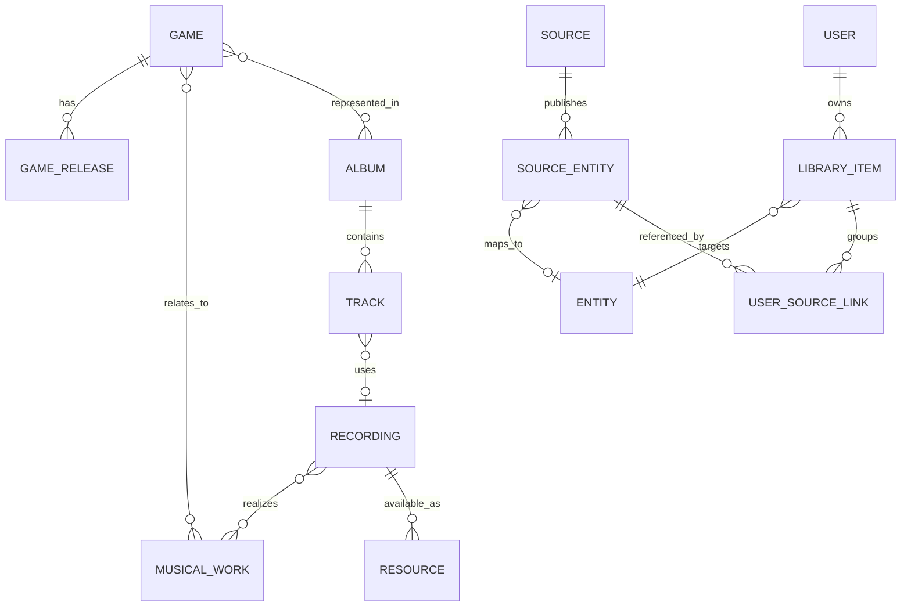

# LoopShelf 기능 및 데이터 모델 명세

상태: **계획안 / 미구현** · 기준일: 2026-10-18

## 제품 범위

장기 목표는 통합 검색, 게임·앨범·곡 탐색, 가능한 음악의 스트리밍, 즐겨찾기·플레이리스트, 검증 가능한 자동 청취 기록, 사용자별 개인 라이브러리입니다.

첫 MVP는 **음원을 재생하지 못해도 가치가 있는 개인 음악 카탈로그**로 정의합니다. 소규모 비공개 셀프호스팅, 하나의 서버와 SQLite 파일을 기준으로 합니다. 공개 가입·상업 운영·모든 아카이브의 전수 인덱싱은 첫 범위에 포함하지 않습니다.

## 첫 MVP

| 기능 | 범위 | 완료 조건 |
| --- | --- | --- |
| 통합 검색 | KHInsider·Zophar의 허용된 앨범 검색 + 로컬 인덱스 | 결과마다 출처·유형·확인 시각 표시. 소스 실패/0건/캐시 결과 구분 |
| 앨범 탐색 | 앨범 정보, 순서 있는 수록곡 목록, 원문 링크 | 같은 번호가 반복되는 트랙과 메타데이터 누락을 손실 없이 표시 |
| 게임 연결 | 확인된 게임 관계로 앨범 탐색 | 제목 추측만으로 게임 관계를 확정하지 않음. 미연결 상태 허용 |
| 개인 라이브러리 | 앨범·곡 저장/제거, 즐겨찾기, 개인 메모 | 새로고침·서버 재시작·소스 장애 뒤에도 저장 내용 유지 |
| 직접 북마크 | 지원 소스의 페이지 URL과 사용자 입력 제목 저장 | 외부 수집 없이도 생성 가능. 자동으로 확인된 메타데이터와 구분 |
| 개인 항목 통합 | 같은 음악에 해당하는 여러 출처를 한 저장 항목에 연결/해제 | 다른 사용자와 전역 카탈로그에 영향을 주지 않고 되돌릴 수 있음 |
| 사용자 격리 | 비공개 설치의 계정·로그인·로그아웃·세션 | 다른 사용자 ID나 항목 ID를 넣어도 조회·수정 불가 |
| 반응형 UI | 검색, 앨범 상세, 내 라이브러리, 소스 상태, 계정 화면 | 모바일 360px 및 데스크톱에서 키보드·터치로 주요 흐름 완료 |
| 기본 PWA | manifest, 아이콘, 앱 셸, 오프라인 안내 | 지원 브라우저 설치 확인. 오프라인에서 작업 성공을 가장하지 않음 |
| 개인 데이터 이식 | 버전 있는 JSON 내보내기/복원 | 사용자 메모·즐겨찾기·출처 연결·안정 ID를 보존. 미디어 제외 |

현재 조사만으로 두 소스의 자동 수집을 활성화할 수 있다고 확정하지 않습니다. 소스별 검증 통과 범위만 켭니다. KHInsider 상세 차단이 지속되면 해당 상세는 원문 열기/기존 캐시/직접 북마크로 제한하고 **부분 연동**으로 표시합니다. 이 경우 두 소스의 전체 상세 연동 목표는 미완료로 남깁니다.

## 다음 단계로 분리할 기능

- 앱 내 스트리밍, 재생 큐, 기본 플레이리스트와 순서 편집, Media Session.
- 실제 앱 재생을 확인한 청취 이력. 외부 사이트 열기 이력과 별도 관리.
- Rainwave 라디오, OC ReMix 피드, 다른 메타데이터 소스 추가.
- 오프라인 개인 라이브러리 열람/동기화, 고급 추천·유사곡·자동 식별.
- 칩 음악 에뮬레이션, 서버 트랜스코딩, 오디오 다운로드/보관은 첫 플레이어 확장에도 기본 제외.
- Decl은 저장소와 분리된 실험으로 검토. MVP의 데이터 영속성·검색에 필수로 넣지 않음.

## 사용자 흐름

1. 로그인한 사용자가 검색어를 제출합니다. 로컬 결과와 활성화된 외부 소스의 결과를 출처·상태와 함께 봅니다.
2. 앨범을 열면 캐시가 있으면 먼저 표시하고, 허용된 경우 상세를 취득합니다. 오래된 캐시에는 갱신 시각을 표시합니다.
3. 앨범 또는 곡을 라이브러리에 저장합니다. 재생 불가 항목도 저장할 수 있습니다.
4. 같은 항목의 다른 출처를 발견하면 기존 개인 항목에 연결하거나 별도 버전으로 저장합니다.
5. 연동이 불가능하면 지원 소스의 페이지 URL과 제목을 직접 저장합니다. 원문 열기는 새 탭에서 수행하며 청취 이력을 만들지 않습니다.

빈 검색어, 검색 중, 결과 없음, 일부 소스 실패, 전체 소스 실패, 로그인 만료, 저장 실패, 오프라인을 서로 다른 상태로 표현합니다. 사이트 상태와 사용자에게 필요한 다음 행동을 보여주며 내부 파서 정보는 운영 로그에 둡니다.

## 음악의 정체성

| 개념 | 의미 | 구분 예 |
| --- | --- | --- |
| Game | 게임이라는 작품 | 같은 게임의 플랫폼별 발매는 GameRelease로 구분 |
| GameRelease | 플랫폼·지역·발매 시점이 다른 게임 버전 | SNES판, DS판 |
| MusicalWork | 추상적인 음악 작품/곡 | 같은 멜로디를 여러 녹음에서 사용 가능 |
| Recording | 특정 연주·렌더링·편집·믹스·루프의 녹음 버전 | OST 마스터, 칩 렌더링, 루프/페이드가 다른 버전 |
| Album | 발매판 또는 아카이브가 구성한 곡 모음 | 정식 OST, 재발매판, gamerip, 편곡 앨범 |
| Track | 앨범에서 녹음이 수록된 위치 | 디스크·표시 번호·정렬 순서·표시 제목 |
| SourceEntity | 특정 사이트의 앨범/곡/게임 레코드 | 소스 ID, 소스 내부 키, 페이지 URL, 출처 정보 |
| Resource | 특정 Recording을 실제 재생할 수 있는 외부 자원 | MP3 URL, MIME, 만료 시각, 정책과 기술 상태 |

MP3와 FLAC이 같은 마스터의 인코딩이라면 같은 Recording의 다른 Resource일 수 있습니다. 루프 수·연주·편곡·렌더링이 다르면 별도 Recording으로 유지합니다. 서로 다른 앨범의 Track이 같은 Recording을 참조할 수도 있습니다.

편곡/리믹스는 필요할 때 별도 MusicalWork와 원곡 관계(`arrangement_of`, `remix_of`)를 둡니다. 메들리는 여러 Work를 표현할 수 있으므로 Recording–Work는 다대다입니다. 이 관계를 추론할 근거가 없으면 비워 두며 트랙마다 확정된 원곡 관계를 만들어내지 않습니다.

Entity는 Game/Album/Track/Recording/Work/Bookmark 등 도메인 항목의 공통 ID 레지스트리입니다. SourceEntity는 이에 연결되며 Resource와 혼동하지 않습니다. 게임·앨범 관계는 컴필레이션을 위해 다대다로 둡니다.

## 논리 저장 구조

아래는 설계 명세이며 SQL이나 마이그레이션을 작성한 상태가 아닙니다. 첫 구현은 MVP에 필요한 테이블부터 도입하고 미래 기능 테이블은 해당 단계에서 추가합니다.

| 영역 | 주요 엔티티 / 필드 | 제약 |
| --- | --- | --- |
| 공통 ID | Entity: id, kind, createdAt, lifecycle | 내부 UUID 유지. 외부 URL을 기본 키로 쓰지 않음 |
| 카탈로그 | Album: title, kind, releaseDate, datePrecision, catalogNumber | 발매판 단위. gamerip은 정식 발매와 구분. 미확인 값은 null |
| 수록곡 | Track: albumId, recordingId?, position, discLabel?, trackLabel?, title, durationMs? | position은 정렬 값. 표시 번호는 반복 가능. 시간 미상과 0초 구분 |
| 음악 관계 | Game, GameRelease, MusicalWork, Recording, 관계 테이블 | 최소 메타데이터만 있으면 source-derived/provisional 상태 허용 |
| 출처 | SourceEntity: sourceId, externalKind, externalKey, entityId?, pageUrl, fetchedAt, parserVersion, availability | `(sourceId, externalKind, externalKey)` 유일. URL 변경 이력 별도 유지 |
| 메타데이터 근거 | Assertion: entityId, field/relation, value, sourceEntityId, observedAt, confidence, method | 원본 주장과 채택한 표시값 구분. 사용자 메모를 수집기로 덮어쓰지 않음 |
| 이름 | Alias: entityId, locale, text, normalizedText, provenance | 원문 유지. 영문·일문·한글 이름을 증거 없이 동일시하지 않음 |
| 개인 저장 | LibraryItem: id, userId, entityId, titleOverride?, note?, favorite, createdAt, updatedAt | `(userId, entityId)` 유일. 사용자 지정 내용은 개인 영역에만 저장 |
| 개인 출처 연결 | UserSourceLink: userId, libraryItemId, sourceEntityId, assertedAt | 소유권 일치. `(userId, sourceEntityId)` 유일. 연결/해제 감사 기록 |
| 직접 북마크 | Bookmark: entityId, ownerId, enteredTitle, enteredUrl | 미검증 개인 엔티티. 다른 사용자의 공용 검색 결과에 노출하지 않음 |
| 운영 | SourcePolicy, FetchCache, SearchCache, AdapterHealth, SchemaVersion | 정책 근거·검토일, 만료, 파서 버전, 장애 상태를 구분 |
| 인증 | User, Session 등 인증 라이브러리 스키마 | 라이브러리 관리 스키마 사용. 비밀번호/키를 로그·공용 캐시에 저장하지 않음 |
| 후속 기능 | Resource, Playlist, PlaylistEntry, PlaybackSession, ListenEvent | Resource URL은 사용자 보관 항목의 ID가 되지 않음 |

Entity를 참조하는 외래 키에 더해 실제 subtype 일치와 개인 엔티티의 소유권도 검증합니다. 파서는 source DTO를 반환하며 어떤 사용자 항목을 연결할지 결정하지 않습니다.

## 중복과 병합 규칙

1. 동일 소스의 동일 외부 키 재취득은 기존 SourceEntity를 갱신합니다. 외부 키가 없어 URL/경로를 임시 키로 써도 내부 UUID는 별도로 유지합니다.
2. 제목·길이·플랫폼은 유사 후보를 찾는 단서입니다. 제목 일치, 비슷한 길이, 같은 게임만으로 소스 간 자동 병합하지 않습니다. 카탈로그 번호 하나만으로도 재발매·판본을 구별하지 못할 수 있습니다.
3. 첫 MVP에서는 전역 카탈로그의 소스 간 병합을 자동화하지 않습니다. 사용자는 자신의 라이브러리에서 여러 출처를 하나의 항목에 묶을 수 있습니다. 이는 개인 판단으로 표시하며 전역 동일성의 증거로 승격하지 않습니다.
4. 출처를 묶어도 각 원본 제목·분류·버전·길이를 보존합니다. 다른 kind의 엔티티를 같은 kind처럼 합치지 않습니다. 녹음 버전이 다른 경우 별도 버전으로 유지하는 안내를 제공합니다.
5. 통합은 트랜잭션으로 처리하고 해제할 수 있습니다. 두 개인 항목을 합칠 때 메모·즐겨찾기 등 충돌 내용을 잃지 않으며 사용자에게 결과를 보여줍니다.
6. 외부 URL 변경·삭제·403은 라이브러리 항목 삭제 이유가 아닙니다. SourceEntity/Resource의 상태를 변경합니다. 권리·정책상 삭제해야 하는 수집 콘텐츠는 제거하되 내부 ID와 허용되는 사용자 메모·최소 북마크는 분리해 보존합니다.
7. 이후 전역 병합을 추가한다면 alias/redirect, 근거, 영향 범위, 되돌리기 기록을 먼저 설계합니다.

## 검색 계약

- 범위: `library`(개인), `catalog`(확보한 공용 메타데이터), `sources`(활성화된 외부 앨범 검색). 개인 메모 검색은 해당 사용자에게만 허용합니다.
- 외부 요청은 검색 제출 시 실행합니다. 키 입력마다 외부 사이트를 호출하지 않습니다.
- 로컬 곡 검색은 수집 완료한 앨범 범위입니다. 전체 사이트의 곡을 검색하는 것처럼 표시하지 않습니다.
- 결과는 소스별 `fresh / cached / stale / empty / blocked / rate-limited / unavailable / disabled`와 검색 범위를 포함합니다. 여러 소스 결과의 개수는 전체 아카이브 총개수로 표시하지 않습니다.
- 내부 정규화는 원문과 분리하고 NFKC·대소문자·공백·별칭을 사용합니다. 한일문 부분 검색과 1–2자 검색의 별도 동작은 ARCHITECTURE.md를 따릅니다.

## 재생과 청취 기록의 후속 계약

플레이어는 정책상 허용 상태와 기술상 재생 가능 상태를 모두 통과한 Resource만 선택합니다. `metadata-only`, `external-only`, `unverified`, `playable`, `expired`, `unavailable`를 구분하며 재생 가능 여부가 저장 가능 여부를 결정하지 않습니다.

청취 이력은 사용자가 실제로 들었다는 보장이 아니라 **앱에서 관찰된 재생 증거**로 정의합니다. 앱 내 audio의 `playing` 이후 재생 위치가 정상적으로 증가한 구간만 누적합니다. pause, waiting, seeking, ended, error와 관찰 공백을 반영하고 seek 점프·로드·버튼 클릭은 재생 시간으로 합산하지 않습니다. 시스템 볼륨이나 사용자의 실제 청취 여부는 확인할 수 없습니다.

제안 기준은 유효 재생 5초부터 세션 이력을 남기고, 곡 재생 집계는 `min(30초, 알려진 길이의 50%)` 도달 시 별도 표시하는 것입니다. 길이 미상은 30초로 처리합니다. 이 수치는 제품 규칙이며 외부 서비스의 기준을 의미하지 않습니다. 짧게 끝난 곡은 종료와 실제 재생량을 함께 보관하고 정상 재생으로 확인한 경우에만 표시합니다. sessionId·이벤트 순번으로 중복 저장을 방지합니다.

원본 사이트 새 탭·iframe 로드·Rainwave의 현재 곡 API만으로 ListenEvent를 만들지 않습니다. 추후 임베드 API가 검증된 이벤트를 제공하면 관찰 방식과 신뢰도를 명시합니다. 이력은 기본 비공개이며 비활성화·삭제·내보내기를 제공합니다.

## MVP 수용 시나리오

- 검색 → 앨범 → 수록곡 → 저장 → 즐겨찾기 → 재접속 후 동일 항목 유지.
- Zophar의 중복 트랙 번호가 별도 행으로 남고, 루프 버전이 원본과 자동 병합되지 않음.
- 한 소스의 403/429/파서 오류가 다른 소스 검색과 기존 라이브러리를 막지 않음.
- 지원 소스의 페이지 URL만 입력해도 북마크 생성. `javascript:`·잘못된 호스트는 거절.
- 서로 다른 사용자가 같은 앨범을 저장해도 메모·즐겨찾기·개인 출처 연결을 볼 수 없음.
- 소스 엔티티 연결/해제와 JSON 내보내기/복원 후 내부 ID와 사용자 내용 보존.
- 앱 설치와 오프라인 안내가 동작하며 개인 API 응답·오디오가 Service Worker 공용 캐시에 남지 않음.
- 두 소스 연동을 완료로 선언하려면 둘 모두 허용된 검색·상세의 성공 사례가 있어야 함. 링크만 제공하면 부분 지원으로 기록.
